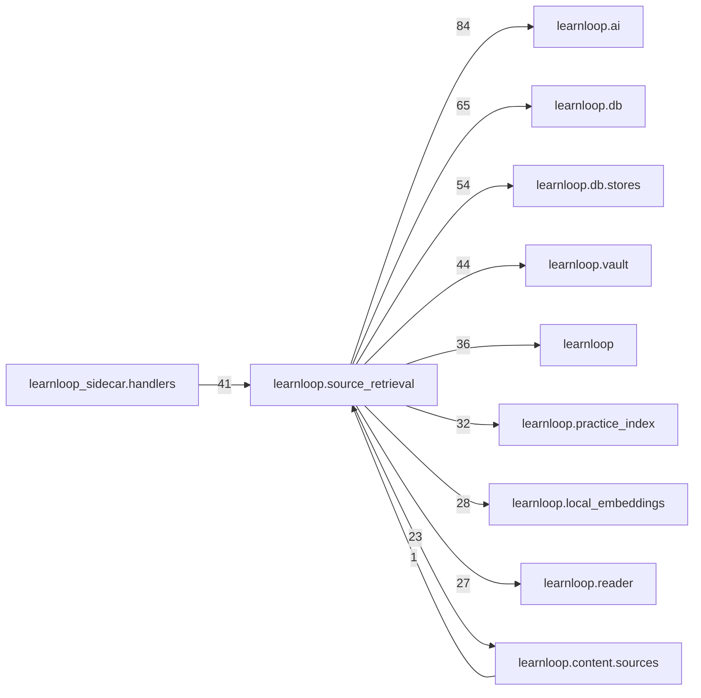

# `learnloop.source_retrieval` package map

> [!info] Generated package map
> This map is generated from live modules and their static imports. Follow module links for source-level facts and canonical concept/workflow links for system behavior.

Up: [[Module Catalog]]

## Responsibility

Source retrieval and the Reader's sources side: keyword and dense search, section coverage, deliverables and paths, and the learner's notes.

For system intent, use [[Architecture Overview]].

^package-purpose

## Module index

| Module | Purpose | Status | Direct importers | Direct test files |
|---|---|---:|---:|---:|
| [[Reference/Modules/learnloop/source_retrieval/__init__|learnloop.source_retrieval]] | [[Reference/Modules/learnloop/source_retrieval/__init__#^module-purpose|purpose]] | `ACTIVE` | 0 | 0 |
| [[Reference/Modules/learnloop/source_retrieval/b4|learnloop.source_retrieval.b4]] | [[Reference/Modules/learnloop/source_retrieval/b4#^module-purpose|purpose]] | `ACTIVE` | 1 | 0 |
| [[Reference/Modules/learnloop/source_retrieval/bench|learnloop.source_retrieval.bench]] | [[Reference/Modules/learnloop/source_retrieval/bench#^module-purpose|purpose]] | `ACTIVE` | 3 | 1 |
| [[Reference/Modules/learnloop/source_retrieval/compare|learnloop.source_retrieval.compare]] | [[Reference/Modules/learnloop/source_retrieval/compare#^module-purpose|purpose]] | `ACTIVE` | 4 | 14 |
| [[Reference/Modules/learnloop/source_retrieval/compare_scope|learnloop.source_retrieval.compare_scope]] | [[Reference/Modules/learnloop/source_retrieval/compare_scope#^module-purpose|purpose]] | `ACTIVE` | 1 | 2 |
| [[Reference/Modules/learnloop/source_retrieval/contracts|learnloop.source_retrieval.contracts]] | [[Reference/Modules/learnloop/source_retrieval/contracts#^module-purpose|purpose]] | `ACTIVE` | 5 | 6 |
| [[Reference/Modules/learnloop/source_retrieval/corpus|learnloop.source_retrieval.corpus]] | [[Reference/Modules/learnloop/source_retrieval/corpus#^module-purpose|purpose]] | `ACTIVE` | 43 | 25 |
| [[Reference/Modules/learnloop/source_retrieval/deliverable_path|learnloop.source_retrieval.deliverable_path]] | [[Reference/Modules/learnloop/source_retrieval/deliverable_path#^module-purpose|purpose]] | `ACTIVE` | 5 | 13 |
| [[Reference/Modules/learnloop/source_retrieval/deliverables|learnloop.source_retrieval.deliverables]] | [[Reference/Modules/learnloop/source_retrieval/deliverables#^module-purpose|purpose]] | `ACTIVE` | 6 | 14 |
| [[Reference/Modules/learnloop/source_retrieval/dense|learnloop.source_retrieval.dense]] | [[Reference/Modules/learnloop/source_retrieval/dense#^module-purpose|purpose]] | `ACTIVE` | 5 | 12 |
| [[Reference/Modules/learnloop/source_retrieval/evaluation|learnloop.source_retrieval.evaluation]] | [[Reference/Modules/learnloop/source_retrieval/evaluation#^module-purpose|purpose]] | `ACTIVE` | 1 | 3 |
| [[Reference/Modules/learnloop/source_retrieval/fallback_space|learnloop.source_retrieval.fallback_space]] | [[Reference/Modules/learnloop/source_retrieval/fallback_space#^module-purpose|purpose]] | `ACTIVE` | 5 | 3 |
| [[Reference/Modules/learnloop/source_retrieval/feedback|learnloop.source_retrieval.feedback]] | [[Reference/Modules/learnloop/source_retrieval/feedback#^module-purpose|purpose]] | `ACTIVE` | 10 | 2 |
| [[Reference/Modules/learnloop/source_retrieval/find_sources|learnloop.source_retrieval.find_sources]] | [[Reference/Modules/learnloop/source_retrieval/find_sources#^module-purpose|purpose]] | `ACTIVE` | 15 | 27 |
| [[Reference/Modules/learnloop/source_retrieval/kept_comparisons|learnloop.source_retrieval.kept_comparisons]] | [[Reference/Modules/learnloop/source_retrieval/kept_comparisons#^module-purpose|purpose]] | `ACTIVE` | 6 | 2 |
| [[Reference/Modules/learnloop/source_retrieval/library|learnloop.source_retrieval.library]] | [[Reference/Modules/learnloop/source_retrieval/library#^module-purpose|purpose]] | `ACTIVE` | 3 | 6 |
| [[Reference/Modules/learnloop/source_retrieval/library_ask|learnloop.source_retrieval.library_ask]] | [[Reference/Modules/learnloop/source_retrieval/library_ask#^module-purpose|purpose]] | `ACTIVE` | 8 | 13 |
| [[Reference/Modules/learnloop/source_retrieval/local_index|learnloop.source_retrieval.local_index]] | [[Reference/Modules/learnloop/source_retrieval/local_index#^module-purpose|purpose]] | `ACTIVE` | 6 | 4 |
| [[Reference/Modules/learnloop/source_retrieval/note_gaps|learnloop.source_retrieval.note_gaps]] | [[Reference/Modules/learnloop/source_retrieval/note_gaps#^module-purpose|purpose]] | `ACTIVE` | 1 | 2 |
| [[Reference/Modules/learnloop/source_retrieval/note_links|learnloop.source_retrieval.note_links]] | [[Reference/Modules/learnloop/source_retrieval/note_links#^module-purpose|purpose]] | `ACTIVE` | 4 | 6 |
| [[Reference/Modules/learnloop/source_retrieval/passage_cues|learnloop.source_retrieval.passage_cues]] | [[Reference/Modules/learnloop/source_retrieval/passage_cues#^module-purpose|purpose]] | `ACTIVE` | 4 | 14 |
| [[Reference/Modules/learnloop/source_retrieval/policy|learnloop.source_retrieval.policy]] | [[Reference/Modules/learnloop/source_retrieval/policy#^module-purpose|purpose]] | `ACTIVE` | 23 | 20 |
| [[Reference/Modules/learnloop/source_retrieval/queries|learnloop.source_retrieval.queries]] | [[Reference/Modules/learnloop/source_retrieval/queries#^module-purpose|purpose]] | `ACTIVE` | 13 | 5 |
| [[Reference/Modules/learnloop/source_retrieval/query_student|learnloop.source_retrieval.query_student]] | [[Reference/Modules/learnloop/source_retrieval/query_student#^module-purpose|purpose]] | `ACTIVE` | 2 | 1 |
| [[Reference/Modules/learnloop/source_retrieval/reader_tutor|learnloop.source_retrieval.reader_tutor]] | [[Reference/Modules/learnloop/source_retrieval/reader_tutor#^module-purpose|purpose]] | `ACTIVE` | 5 | 1 |
| [[Reference/Modules/learnloop/source_retrieval/reading_paths|learnloop.source_retrieval.reading_paths]] | [[Reference/Modules/learnloop/source_retrieval/reading_paths#^module-purpose|purpose]] | `ACTIVE` | 7 | 6 |
| [[Reference/Modules/learnloop/source_retrieval/recipes|learnloop.source_retrieval.recipes]] | [[Reference/Modules/learnloop/source_retrieval/recipes#^module-purpose|purpose]] | `ACTIVE` | 16 | 11 |
| [[Reference/Modules/learnloop/source_retrieval/role_labeller|learnloop.source_retrieval.role_labeller]] | [[Reference/Modules/learnloop/source_retrieval/role_labeller#^module-purpose|purpose]] | `ACTIVE` | 1 | 1 |
| [[Reference/Modules/learnloop/source_retrieval/search|learnloop.source_retrieval.search]] | [[Reference/Modules/learnloop/source_retrieval/search#^module-purpose|purpose]] | `ACTIVE` | 11 | 10 |
| [[Reference/Modules/learnloop/source_retrieval/section_coverage|learnloop.source_retrieval.section_coverage]] | [[Reference/Modules/learnloop/source_retrieval/section_coverage#^module-purpose|purpose]] | `ACTIVE` | 14 | 18 |
| [[Reference/Modules/learnloop/source_retrieval/service_spend|learnloop.source_retrieval.service_spend]] | [[Reference/Modules/learnloop/source_retrieval/service_spend#^module-purpose|purpose]] | `ACTIVE` | 21 | 4 |
| [[Reference/Modules/learnloop/source_retrieval/source_vectors|learnloop.source_retrieval.source_vectors]] | [[Reference/Modules/learnloop/source_retrieval/source_vectors#^module-purpose|purpose]] | `ACTIVE` | 5 | 3 |
| [[Reference/Modules/learnloop/source_retrieval/spaces|learnloop.source_retrieval.spaces]] | [[Reference/Modules/learnloop/source_retrieval/spaces#^module-purpose|purpose]] | `ACTIVE` | 5 | 3 |
| [[Reference/Modules/learnloop/source_retrieval/student_data|learnloop.source_retrieval.student_data]] | [[Reference/Modules/learnloop/source_retrieval/student_data#^module-purpose|purpose]] | `ACTIVE` | 3 | 3 |
| [[Reference/Modules/learnloop/source_retrieval/student_encoder|learnloop.source_retrieval.student_encoder]] | [[Reference/Modules/learnloop/source_retrieval/student_encoder#^module-purpose|purpose]] | `ACTIVE` | 4 | 3 |
| [[Reference/Modules/learnloop/source_retrieval/suggest|learnloop.source_retrieval.suggest]] | [[Reference/Modules/learnloop/source_retrieval/suggest#^module-purpose|purpose]] | `ACTIVE` | 2 | 2 |
| [[Reference/Modules/learnloop/source_retrieval/suites|learnloop.source_retrieval.suites]] | [[Reference/Modules/learnloop/source_retrieval/suites#^module-purpose|purpose]] | `ACTIVE` | 1 | 6 |
| [[Reference/Modules/learnloop/source_retrieval/timing|learnloop.source_retrieval.timing]] | [[Reference/Modules/learnloop/source_retrieval/timing#^module-purpose|purpose]] | `ACTIVE` | 1 | 1 |
| [[Reference/Modules/learnloop/source_retrieval/tutor|learnloop.source_retrieval.tutor]] | [[Reference/Modules/learnloop/source_retrieval/tutor#^module-purpose|purpose]] | `ACTIVE` | 7 | 14 |
| [[Reference/Modules/learnloop/source_retrieval/vault_notes|learnloop.source_retrieval.vault_notes]] | [[Reference/Modules/learnloop/source_retrieval/vault_notes#^module-purpose|purpose]] | `ACTIVE` | 3 | 5 |
| [[Reference/Modules/learnloop/source_retrieval/verify|learnloop.source_retrieval.verify]] | [[Reference/Modules/learnloop/source_retrieval/verify#^module-purpose|purpose]] | `ACTIVE` | 7 | 3 |
| [[Reference/Modules/learnloop/source_retrieval/windows|learnloop.source_retrieval.windows]] | [[Reference/Modules/learnloop/source_retrieval/windows#^module-purpose|purpose]] | `ACTIVE` | 6 | 4 |

## Cross-package dependencies

### This package imports

- [[Reference/Modules/learnloop/ai/_package|learnloop.ai]] — 84 static module edges
- [[Reference/Modules/learnloop/db/_package|learnloop.db]] — 65 static module edges
- [[Reference/Modules/learnloop/db/stores/_package|learnloop.db.stores]] — 54 static module edges
- [[Reference/Modules/learnloop/vault/_package|learnloop.vault]] — 44 static module edges
- [[Reference/Modules/learnloop/_package|learnloop]] — 36 static module edges
- [[Reference/Modules/learnloop/practice_index/_package|learnloop.practice_index]] — 32 static module edges
- [[Reference/Modules/learnloop/local_embeddings/_package|learnloop.local_embeddings]] — 28 static module edges
- [[Reference/Modules/learnloop/reader/_package|learnloop.reader]] — 27 static module edges
- [[Reference/Modules/learnloop/content/sources/_package|learnloop.content.sources]] — 23 static module edges
- [[Reference/Modules/learnloop/ingest/_package|learnloop.ingest]] — 8 static module edges
- [[Reference/Modules/learnloop/ops/_package|learnloop.ops]] — 8 static module edges
- [[Reference/Modules/learnloop/tutor/_package|learnloop.tutor]] — 6 static module edges
- [[Reference/Modules/learnloop/attempts/_package|learnloop.attempts]] — 4 static module edges
- [[Reference/Modules/learnloop/config/_package|learnloop.config]] — 4 static module edges
- [[Reference/Modules/learnloop/goals/_package|learnloop.goals]] — 4 static module edges
- [[Reference/Modules/learnloop/content/authoring/_package|learnloop.content.authoring]] — 3 static module edges
- [[Reference/Modules/learnloop/scheduling/intent/_package|learnloop.scheduling.intent]] — 3 static module edges
- [[Reference/Modules/learnloop/ai/providers/_package|learnloop.ai.providers]] — 2 static module edges
- [[Reference/Modules/learnloop/placement/_package|learnloop.placement]] — 2 static module edges
- [[Reference/Modules/learnloop/substrate/_package|learnloop.substrate]] — 2 static module edges
- [[Reference/Modules/learnloop/curriculum/_package|learnloop.curriculum]] — 1 static module edge
- [[Reference/Modules/learnloop/diagnosis/_package|learnloop.diagnosis]] — 1 static module edge
- [[Reference/Modules/learnloop/diagnosis/text_gaps/_package|learnloop.diagnosis.text_gaps]] — 1 static module edge
- [[Reference/Modules/learnloop/intent/_package|learnloop.intent]] — 1 static module edge
- [[Reference/Modules/learnloop/learner/_package|learnloop.learner]] — 1 static module edge
- [[Reference/Modules/learnloop/params/_package|learnloop.params]] — 1 static module edge
- [[Reference/Modules/learnloop/scheduling/_package|learnloop.scheduling]] — 1 static module edge

### Packages that import this package

- [[Reference/Modules/learnloop_sidecar/handlers/_package|learnloop_sidecar.handlers]] — 41 static module edges
- [[Reference/Modules/learnloop/instructional/_package|learnloop.instructional]] — 23 static module edges
- [[Reference/Modules/learnloop/cli/_package|learnloop.cli]] — 19 static module edges
- [[Reference/Modules/learnloop/experiments/contextual_embeddings/_package|learnloop.experiments.contextual_embeddings]] — 11 static module edges
- [[Reference/Modules/learnloop/figures/_package|learnloop.figures]] — 10 static module edges
- [[Reference/Modules/learnloop/teacher/_package|learnloop.teacher]] — 10 static module edges
- [[Reference/Modules/learnloop/content/pipeline/_package|learnloop.content.pipeline]] — 9 static module edges
- [[Reference/Modules/learnloop/workbench/_package|learnloop.workbench]] — 8 static module edges
- [[Reference/Modules/learnloop/daily_plan/_package|learnloop.daily_plan]] — 5 static module edges
- [[Reference/Modules/learnloop/remote/_package|learnloop.remote]] — 5 static module edges
- [[Reference/Modules/learnloop/hints/_package|learnloop.hints]] — 4 static module edges
- [[Reference/Modules/learnloop/content/authoring/_package|learnloop.content.authoring]] — 3 static module edges
- [[Reference/Modules/learnloop/adaptive_difficulty/_package|learnloop.adaptive_difficulty]] — 2 static module edges
- [[Reference/Modules/learnloop/content/sources/_package|learnloop.content.sources]] — 1 static module edge
- [[Reference/Modules/learnloop/diagnosis/text_gaps/_package|learnloop.diagnosis.text_gaps]] — 1 static module edge

### Dependency neighborhood

This diagram compresses package-level static imports; edge labels are distinct module-to-module import counts.



Interpretation: arrow direction is static import direction and the label is the number of distinct module-to-module edges. It shows coupling pressure, not runtime call frequency or ownership permission.

## Workflow entry points

- [[Initialize a Vault]]
- [[Start a Learning Cycle]]

## Find and filter

Use Obsidian's native search:

```query
path:"Reference/Modules/learnloop/source_retrieval" tag:#docs/module
```

To change this package, start with a module's [[#Module index|purpose link]], then follow its callers, tests, and modification guidance. Re-run the generator after source changes.
