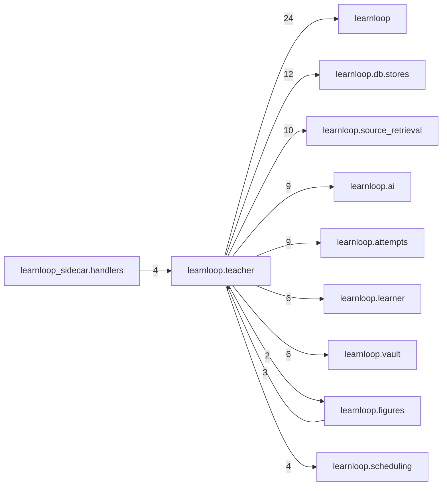

# `learnloop.teacher` package map

> [!info] Generated package map
> This map is generated from live modules and their static imports. Follow module links for source-level facts and canonical concept/workflow links for system behavior.

Up: [[Module Catalog]]

## Responsibility

Lessons on the latent learner state: the brief, the teacher's turn contract and actions, guards, checks, delayed checks and receipts.

For system intent, use [[Architecture Overview]].

^package-purpose

## Module index

| Module | Purpose | Status | Direct importers | Direct test files |
|---|---|---:|---:|---:|
| [[Reference/Modules/learnloop/teacher/__init__|learnloop.teacher]] | [[Reference/Modules/learnloop/teacher/__init__#^module-purpose|purpose]] | `ACTIVE` | 0 | 1 |
| [[Reference/Modules/learnloop/teacher/actions|learnloop.teacher.actions]] | [[Reference/Modules/learnloop/teacher/actions#^module-purpose|purpose]] | `ACTIVE` | 1 | 1 |
| [[Reference/Modules/learnloop/teacher/brief|learnloop.teacher.brief]] | [[Reference/Modules/learnloop/teacher/brief#^module-purpose|purpose]] | `ACTIVE` | 7 | 6 |
| [[Reference/Modules/learnloop/teacher/checks|learnloop.teacher.checks]] | [[Reference/Modules/learnloop/teacher/checks#^module-purpose|purpose]] | `ACTIVE` | 2 | 2 |
| [[Reference/Modules/learnloop/teacher/contracts|learnloop.teacher.contracts]] | [[Reference/Modules/learnloop/teacher/contracts#^module-purpose|purpose]] | `ACTIVE` | 8 | 4 |
| [[Reference/Modules/learnloop/teacher/delayed|learnloop.teacher.delayed]] | [[Reference/Modules/learnloop/teacher/delayed#^module-purpose|purpose]] | `ACTIVE` | 2 | 2 |
| [[Reference/Modules/learnloop/teacher/doctrines|learnloop.teacher.doctrines]] | [[Reference/Modules/learnloop/teacher/doctrines#^module-purpose|purpose]] | `ACTIVE` | 2 | 2 |
| [[Reference/Modules/learnloop/teacher/episodes|learnloop.teacher.episodes]] | [[Reference/Modules/learnloop/teacher/episodes#^module-purpose|purpose]] | `ACTIVE` | 4 | 5 |
| [[Reference/Modules/learnloop/teacher/exposure|learnloop.teacher.exposure]] | [[Reference/Modules/learnloop/teacher/exposure#^module-purpose|purpose]] | `ACTIVE` | 2 | 0 |
| [[Reference/Modules/learnloop/teacher/guards|learnloop.teacher.guards]] | [[Reference/Modules/learnloop/teacher/guards#^module-purpose|purpose]] | `ACTIVE` | 2 | 1 |
| [[Reference/Modules/learnloop/teacher/notes|learnloop.teacher.notes]] | [[Reference/Modules/learnloop/teacher/notes#^module-purpose|purpose]] | `ACTIVE` | 2 | 1 |
| [[Reference/Modules/learnloop/teacher/probes|learnloop.teacher.probes]] | [[Reference/Modules/learnloop/teacher/probes#^module-purpose|purpose]] | `ACTIVE` | 2 | 3 |
| [[Reference/Modules/learnloop/teacher/report|learnloop.teacher.report]] | [[Reference/Modules/learnloop/teacher/report#^module-purpose|purpose]] | `ACTIVE` | 1 | 3 |
| [[Reference/Modules/learnloop/teacher/service|learnloop.teacher.service]] | [[Reference/Modules/learnloop/teacher/service#^module-purpose|purpose]] | `ACTIVE` | 3 | 31 |
| [[Reference/Modules/learnloop/teacher/te2|learnloop.teacher.te2]] | [[Reference/Modules/learnloop/teacher/te2#^module-purpose|purpose]] | `ACTIVE` | 6 | 2 |
| [[Reference/Modules/learnloop/teacher/topics|learnloop.teacher.topics]] | [[Reference/Modules/learnloop/teacher/topics#^module-purpose|purpose]] | `ACTIVE` | 2 | 2 |
| [[Reference/Modules/learnloop/teacher/visuals|learnloop.teacher.visuals]] | [[Reference/Modules/learnloop/teacher/visuals#^module-purpose|purpose]] | `ACTIVE` | 2 | 5 |

## Cross-package dependencies

### This package imports

- [[Reference/Modules/learnloop/_package|learnloop]] — 24 static module edges
- [[Reference/Modules/learnloop/db/stores/_package|learnloop.db.stores]] — 12 static module edges
- [[Reference/Modules/learnloop/source_retrieval/_package|learnloop.source_retrieval]] — 10 static module edges
- [[Reference/Modules/learnloop/ai/_package|learnloop.ai]] — 9 static module edges
- [[Reference/Modules/learnloop/attempts/_package|learnloop.attempts]] — 9 static module edges
- [[Reference/Modules/learnloop/learner/_package|learnloop.learner]] — 6 static module edges
- [[Reference/Modules/learnloop/vault/_package|learnloop.vault]] — 6 static module edges
- [[Reference/Modules/learnloop/scheduling/_package|learnloop.scheduling]] — 4 static module edges
- [[Reference/Modules/learnloop/followup_serve/_package|learnloop.followup_serve]] — 3 static module edges
- [[Reference/Modules/learnloop/tutor/_package|learnloop.tutor]] — 3 static module edges
- [[Reference/Modules/learnloop/content/authoring/_package|learnloop.content.authoring]] — 2 static module edges
- [[Reference/Modules/learnloop/figures/_package|learnloop.figures]] — 2 static module edges
- [[Reference/Modules/learnloop/router_objective/_package|learnloop.router_objective]] — 2 static module edges
- [[Reference/Modules/learnloop/adaptive_difficulty/_package|learnloop.adaptive_difficulty]] — 1 static module edge
- [[Reference/Modules/learnloop/content/sources/_package|learnloop.content.sources]] — 1 static module edge
- [[Reference/Modules/learnloop/curriculum/_package|learnloop.curriculum]] — 1 static module edge
- [[Reference/Modules/learnloop/data_capture/_package|learnloop.data_capture]] — 1 static module edge
- [[Reference/Modules/learnloop/db/_package|learnloop.db]] — 1 static module edge
- [[Reference/Modules/learnloop/diagnosis/text_gaps/_package|learnloop.diagnosis.text_gaps]] — 1 static module edge
- [[Reference/Modules/learnloop/evsi_calibration/_package|learnloop.evsi_calibration]] — 1 static module edge
- [[Reference/Modules/learnloop/ingest/_package|learnloop.ingest]] — 1 static module edge
- [[Reference/Modules/learnloop/instructional/_package|learnloop.instructional]] — 1 static module edge

### Packages that import this package

- [[Reference/Modules/learnloop_sidecar/handlers/_package|learnloop_sidecar.handlers]] — 4 static module edges
- [[Reference/Modules/learnloop/figures/_package|learnloop.figures]] — 3 static module edges
- [[Reference/Modules/learnloop/followup_run/_package|learnloop.followup_run]] — 2 static module edges
- [[Reference/Modules/learnloop_sidecar/_package|learnloop_sidecar]] — 2 static module edges
- [[Reference/Modules/learnloop/cli/_package|learnloop.cli]] — 1 static module edge

### Dependency neighborhood

This diagram compresses package-level static imports; edge labels are distinct module-to-module import counts.



Interpretation: arrow direction is static import direction and the label is the number of distinct module-to-module edges. It shows coupling pressure, not runtime call frequency or ownership permission.

## Workflow entry points

- [[Initialize a Vault]]
- [[Start a Learning Cycle]]

## Find and filter

Use Obsidian's native search:

```query
path:"Reference/Modules/learnloop/teacher" tag:#docs/module
```

To change this package, start with a module's [[#Module index|purpose link]], then follow its callers, tests, and modification guidance. Re-run the generator after source changes.
