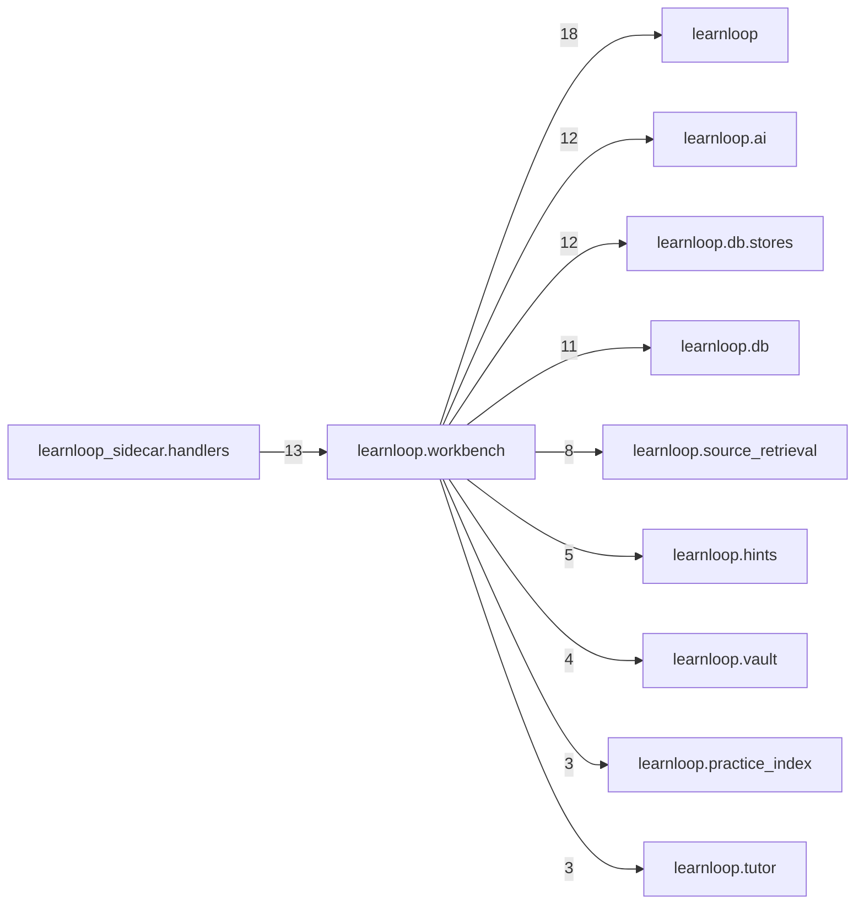

# `learnloop.workbench` package map

> [!info] Generated package map
> This map is generated from live modules and their static imports. Follow module links for source-level facts and canonical concept/workflow links for system behavior.

Up: [[Module Catalog]]

## Responsibility

The Reader workbench's checks and the help ladder's Reader side: Check my work, declared symbolic checks and the ladder.

For system intent, use [[Architecture Overview]].

^package-purpose

## Module index

| Module | Purpose | Status | Direct importers | Direct test files |
|---|---|---:|---:|---:|
| [[Reference/Modules/learnloop/workbench/__init__|learnloop.workbench]] | [[Reference/Modules/learnloop/workbench/__init__#^module-purpose|purpose]] | `ACTIVE` | 0 | 0 |
| [[Reference/Modules/learnloop/workbench/bridge|learnloop.workbench.bridge]] | [[Reference/Modules/learnloop/workbench/bridge#^module-purpose|purpose]] | `ACTIVE` | 2 | 3 |
| [[Reference/Modules/learnloop/workbench/check|learnloop.workbench.check]] | [[Reference/Modules/learnloop/workbench/check#^module-purpose|purpose]] | `ACTIVE` | 5 | 5 |
| [[Reference/Modules/learnloop/workbench/compare_methods|learnloop.workbench.compare_methods]] | [[Reference/Modules/learnloop/workbench/compare_methods#^module-purpose|purpose]] | `ACTIVE` | 2 | 2 |
| [[Reference/Modules/learnloop/workbench/help_outcomes|learnloop.workbench.help_outcomes]] | [[Reference/Modules/learnloop/workbench/help_outcomes#^module-purpose|purpose]] | `ACTIVE` | 1 | 5 |
| [[Reference/Modules/learnloop/workbench/ladder|learnloop.workbench.ladder]] | [[Reference/Modules/learnloop/workbench/ladder#^module-purpose|purpose]] | `ACTIVE` | 4 | 0 |
| [[Reference/Modules/learnloop/workbench/passage_draw|learnloop.workbench.passage_draw]] | [[Reference/Modules/learnloop/workbench/passage_draw#^module-purpose|purpose]] | `ACTIVE` | 4 | 3 |
| [[Reference/Modules/learnloop/workbench/route_example|learnloop.workbench.route_example]] | [[Reference/Modules/learnloop/workbench/route_example#^module-purpose|purpose]] | `ACTIVE` | 4 | 1 |
| [[Reference/Modules/learnloop/workbench/symbolic|learnloop.workbench.symbolic]] | [[Reference/Modules/learnloop/workbench/symbolic#^module-purpose|purpose]] | `ACTIVE` | 1 | 8 |

## Cross-package dependencies

### This package imports

- [[Reference/Modules/learnloop/_package|learnloop]] — 18 static module edges
- [[Reference/Modules/learnloop/ai/_package|learnloop.ai]] — 12 static module edges
- [[Reference/Modules/learnloop/db/stores/_package|learnloop.db.stores]] — 12 static module edges
- [[Reference/Modules/learnloop/db/_package|learnloop.db]] — 11 static module edges
- [[Reference/Modules/learnloop/source_retrieval/_package|learnloop.source_retrieval]] — 8 static module edges
- [[Reference/Modules/learnloop/hints/_package|learnloop.hints]] — 5 static module edges
- [[Reference/Modules/learnloop/vault/_package|learnloop.vault]] — 4 static module edges
- [[Reference/Modules/learnloop/practice_index/_package|learnloop.practice_index]] — 3 static module edges
- [[Reference/Modules/learnloop/tutor/_package|learnloop.tutor]] — 3 static module edges
- [[Reference/Modules/learnloop/instructional/_package|learnloop.instructional]] — 2 static module edges
- [[Reference/Modules/learnloop/reader/_package|learnloop.reader]] — 2 static module edges
- [[Reference/Modules/learnloop/attempts/_package|learnloop.attempts]] — 1 static module edge
- [[Reference/Modules/learnloop/content/authoring/_package|learnloop.content.authoring]] — 1 static module edge
- [[Reference/Modules/learnloop/content/sources/_package|learnloop.content.sources]] — 1 static module edge
- [[Reference/Modules/learnloop/diagnosis/text_gaps/_package|learnloop.diagnosis.text_gaps]] — 1 static module edge
- [[Reference/Modules/learnloop/ingest/_package|learnloop.ingest]] — 1 static module edge
- [[Reference/Modules/learnloop/learner/_package|learnloop.learner]] — 1 static module edge
- [[Reference/Modules/learnloop/substrate/_package|learnloop.substrate]] — 1 static module edge

### Packages that import this package

- [[Reference/Modules/learnloop_sidecar/handlers/_package|learnloop_sidecar.handlers]] — 13 static module edges

### Dependency neighborhood

This diagram compresses package-level static imports; edge labels are distinct module-to-module import counts.



Interpretation: arrow direction is static import direction and the label is the number of distinct module-to-module edges. It shows coupling pressure, not runtime call frequency or ownership permission.

## Workflow entry points

- [[Initialize a Vault]]
- [[Start a Learning Cycle]]

## Find and filter

Use Obsidian's native search:

```query
path:"Reference/Modules/learnloop/workbench" tag:#docs/module
```

To change this package, start with a module's [[#Module index|purpose link]], then follow its callers, tests, and modification guidance. Re-run the generator after source changes.
