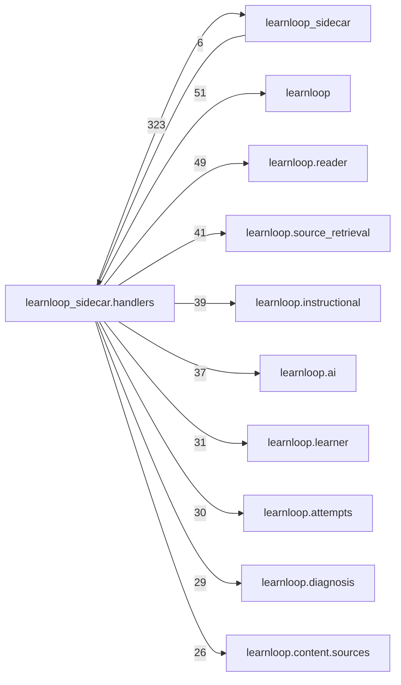

# `learnloop_sidecar.handlers` package map

> [!info] Generated package map
> This map is generated from live modules and their static imports. Follow module links for source-level facts and canonical concept/workflow links for system behavior.

Up: [[Module Catalog]]

## Responsibility

RPC adapters that validate requests and delegate to domain and infrastructure APIs.

For system intent, use [[Architecture Overview]].

^package-purpose

## Module index

| Module | Purpose | Status | Direct importers | Direct test files |
|---|---|---:|---:|---:|
| [[Reference/Modules/learnloop_sidecar/handlers/__init__|learnloop_sidecar.handlers]] | [[Reference/Modules/learnloop_sidecar/handlers/__init__#^module-purpose|purpose]] | `ACTIVE` | 1 | 153 |
| [[Reference/Modules/learnloop_sidecar/handlers/adaptive_difficulty|learnloop_sidecar.handlers.adaptive_difficulty]] | [[Reference/Modules/learnloop_sidecar/handlers/adaptive_difficulty#^module-purpose|purpose]] | `ACTIVE` | 1 | 2 |
| [[Reference/Modules/learnloop_sidecar/handlers/adjudication|learnloop_sidecar.handlers.adjudication]] | [[Reference/Modules/learnloop_sidecar/handlers/adjudication#^module-purpose|purpose]] | `ACTIVE` | 1 | 0 |
| [[Reference/Modules/learnloop_sidecar/handlers/ai_providers|learnloop_sidecar.handlers.ai_providers]] | [[Reference/Modules/learnloop_sidecar/handlers/ai_providers#^module-purpose|purpose]] | `ACTIVE` | 12 | 17 |
| [[Reference/Modules/learnloop_sidecar/handlers/animation|learnloop_sidecar.handlers.animation]] | [[Reference/Modules/learnloop_sidecar/handlers/animation#^module-purpose|purpose]] | `ACTIVE` | 1 | 1 |
| [[Reference/Modules/learnloop_sidecar/handlers/app|learnloop_sidecar.handlers.app]] | [[Reference/Modules/learnloop_sidecar/handlers/app#^module-purpose|purpose]] | `ACTIVE` | 1 | 0 |
| [[Reference/Modules/learnloop_sidecar/handlers/as_printed|learnloop_sidecar.handlers.as_printed]] | [[Reference/Modules/learnloop_sidecar/handlers/as_printed#^module-purpose|purpose]] | `ACTIVE` | 2 | 4 |
| [[Reference/Modules/learnloop_sidecar/handlers/calibration|learnloop_sidecar.handlers.calibration]] | [[Reference/Modules/learnloop_sidecar/handlers/calibration#^module-purpose|purpose]] | `ACTIVE` | 1 | 0 |
| [[Reference/Modules/learnloop_sidecar/handlers/capture|learnloop_sidecar.handlers.capture]] | [[Reference/Modules/learnloop_sidecar/handlers/capture#^module-purpose|purpose]] | `ACTIVE` | 4 | 2 |
| [[Reference/Modules/learnloop_sidecar/handlers/chatgpt_plan|learnloop_sidecar.handlers.chatgpt_plan]] | [[Reference/Modules/learnloop_sidecar/handlers/chatgpt_plan#^module-purpose|purpose]] | `ACTIVE` | 2 | 2 |
| [[Reference/Modules/learnloop_sidecar/handlers/claims|learnloop_sidecar.handlers.claims]] | [[Reference/Modules/learnloop_sidecar/handlers/claims#^module-purpose|purpose]] | `ACTIVE` | 1 | 0 |
| [[Reference/Modules/learnloop_sidecar/handlers/cli|learnloop_sidecar.handlers.cli]] | [[Reference/Modules/learnloop_sidecar/handlers/cli#^module-purpose|purpose]] | `ACTIVE` | 1 | 0 |
| [[Reference/Modules/learnloop_sidecar/handlers/compare_scope|learnloop_sidecar.handlers.compare_scope]] | [[Reference/Modules/learnloop_sidecar/handlers/compare_scope#^module-purpose|purpose]] | `ACTIVE` | 2 | 1 |
| [[Reference/Modules/learnloop_sidecar/handlers/correspondents|learnloop_sidecar.handlers.correspondents]] | [[Reference/Modules/learnloop_sidecar/handlers/correspondents#^module-purpose|purpose]] | `ACTIVE` | 2 | 3 |
| [[Reference/Modules/learnloop_sidecar/handlers/daily_plan|learnloop_sidecar.handlers.daily_plan]] | [[Reference/Modules/learnloop_sidecar/handlers/daily_plan#^module-purpose|purpose]] | `ACTIVE` | 4 | 12 |
| [[Reference/Modules/learnloop_sidecar/handlers/deliverables|learnloop_sidecar.handlers.deliverables]] | [[Reference/Modules/learnloop_sidecar/handlers/deliverables#^module-purpose|purpose]] | `ACTIVE` | 2 | 10 |
| [[Reference/Modules/learnloop_sidecar/handlers/diagnosis_card|learnloop_sidecar.handlers.diagnosis_card]] | [[Reference/Modules/learnloop_sidecar/handlers/diagnosis_card#^module-purpose|purpose]] | `ACTIVE` | 1 | 0 |
| [[Reference/Modules/learnloop_sidecar/handlers/exams|learnloop_sidecar.handlers.exams]] | [[Reference/Modules/learnloop_sidecar/handlers/exams#^module-purpose|purpose]] | `ACTIVE` | 1 | 5 |
| [[Reference/Modules/learnloop_sidecar/handlers/facet_detail|learnloop_sidecar.handlers.facet_detail]] | [[Reference/Modules/learnloop_sidecar/handlers/facet_detail#^module-purpose|purpose]] | `ACTIVE` | 1 | 0 |
| [[Reference/Modules/learnloop_sidecar/handlers/facet_identity|learnloop_sidecar.handlers.facet_identity]] | [[Reference/Modules/learnloop_sidecar/handlers/facet_identity#^module-purpose|purpose]] | `ACTIVE` | 1 | 0 |
| [[Reference/Modules/learnloop_sidecar/handlers/facets|learnloop_sidecar.handlers.facets]] | [[Reference/Modules/learnloop_sidecar/handlers/facets#^module-purpose|purpose]] | `ACTIVE` | 1 | 0 |
| [[Reference/Modules/learnloop_sidecar/handlers/feedback|learnloop_sidecar.handlers.feedback]] | [[Reference/Modules/learnloop_sidecar/handlers/feedback#^module-purpose|purpose]] | `ACTIVE` | 1 | 5 |
| [[Reference/Modules/learnloop_sidecar/handlers/figures|learnloop_sidecar.handlers.figures]] | [[Reference/Modules/learnloop_sidecar/handlers/figures#^module-purpose|purpose]] | `ACTIVE` | 4 | 8 |
| [[Reference/Modules/learnloop_sidecar/handlers/first_run|learnloop_sidecar.handlers.first_run]] | [[Reference/Modules/learnloop_sidecar/handlers/first_run#^module-purpose|purpose]] | `ACTIVE` | 1 | 4 |
| [[Reference/Modules/learnloop_sidecar/handlers/followup|learnloop_sidecar.handlers.followup]] | [[Reference/Modules/learnloop_sidecar/handlers/followup#^module-purpose|purpose]] | `ACTIVE` | 1 | 0 |
| [[Reference/Modules/learnloop_sidecar/handlers/goals|learnloop_sidecar.handlers.goals]] | [[Reference/Modules/learnloop_sidecar/handlers/goals#^module-purpose|purpose]] | `ACTIVE` | 4 | 0 |
| [[Reference/Modules/learnloop_sidecar/handlers/graph|learnloop_sidecar.handlers.graph]] | [[Reference/Modules/learnloop_sidecar/handlers/graph#^module-purpose|purpose]] | `ACTIVE` | 1 | 0 |
| [[Reference/Modules/learnloop_sidecar/handlers/graph_edit|learnloop_sidecar.handlers.graph_edit]] | [[Reference/Modules/learnloop_sidecar/handlers/graph_edit#^module-purpose|purpose]] | `ACTIVE` | 1 | 0 |
| [[Reference/Modules/learnloop_sidecar/handlers/hints|learnloop_sidecar.handlers.hints]] | [[Reference/Modules/learnloop_sidecar/handlers/hints#^module-purpose|purpose]] | `ACTIVE` | 2 | 7 |
| [[Reference/Modules/learnloop_sidecar/handlers/ingest|learnloop_sidecar.handlers.ingest]] | [[Reference/Modules/learnloop_sidecar/handlers/ingest#^module-purpose|purpose]] | `ACTIVE` | 4 | 8 |
| [[Reference/Modules/learnloop_sidecar/handlers/inspector|learnloop_sidecar.handlers.inspector]] | [[Reference/Modules/learnloop_sidecar/handlers/inspector#^module-purpose|purpose]] | `ACTIVE` | 1 | 0 |
| [[Reference/Modules/learnloop_sidecar/handlers/intent|learnloop_sidecar.handlers.intent]] | [[Reference/Modules/learnloop_sidecar/handlers/intent#^module-purpose|purpose]] | `ACTIVE` | 1 | 2 |
| [[Reference/Modules/learnloop_sidecar/handlers/item_authoring|learnloop_sidecar.handlers.item_authoring]] | [[Reference/Modules/learnloop_sidecar/handlers/item_authoring#^module-purpose|purpose]] | `ACTIVE` | 2 | 3 |
| [[Reference/Modules/learnloop_sidecar/handlers/item_text_neighbors|learnloop_sidecar.handlers.item_text_neighbors]] | [[Reference/Modules/learnloop_sidecar/handlers/item_text_neighbors#^module-purpose|purpose]] | `ACTIVE` | 1 | 1 |
| [[Reference/Modules/learnloop_sidecar/handlers/kept_comparisons|learnloop_sidecar.handlers.kept_comparisons]] | [[Reference/Modules/learnloop_sidecar/handlers/kept_comparisons#^module-purpose|purpose]] | `ACTIVE` | 2 | 1 |
| [[Reference/Modules/learnloop_sidecar/handlers/knowledge_map|learnloop_sidecar.handlers.knowledge_map]] | [[Reference/Modules/learnloop_sidecar/handlers/knowledge_map#^module-purpose|purpose]] | `ACTIVE` | 1 | 4 |
| [[Reference/Modules/learnloop_sidecar/handlers/knowledge_model|learnloop_sidecar.handlers.knowledge_model]] | [[Reference/Modules/learnloop_sidecar/handlers/knowledge_model#^module-purpose|purpose]] | `ACTIVE` | 1 | 0 |
| [[Reference/Modules/learnloop_sidecar/handlers/learner_gaps|learnloop_sidecar.handlers.learner_gaps]] | [[Reference/Modules/learnloop_sidecar/handlers/learner_gaps#^module-purpose|purpose]] | `ACTIVE` | 4 | 3 |
| [[Reference/Modules/learnloop_sidecar/handlers/lesson|learnloop_sidecar.handlers.lesson]] | [[Reference/Modules/learnloop_sidecar/handlers/lesson#^module-purpose|purpose]] | `ACTIVE` | 1 | 10 |
| [[Reference/Modules/learnloop_sidecar/handlers/library|learnloop_sidecar.handlers.library]] | [[Reference/Modules/learnloop_sidecar/handlers/library#^module-purpose|purpose]] | `ACTIVE` | 1 | 0 |
| [[Reference/Modules/learnloop_sidecar/handlers/library_ask|learnloop_sidecar.handlers.library_ask]] | [[Reference/Modules/learnloop_sidecar/handlers/library_ask#^module-purpose|purpose]] | `ACTIVE` | 7 | 6 |
| [[Reference/Modules/learnloop_sidecar/handlers/library_exercises|learnloop_sidecar.handlers.library_exercises]] | [[Reference/Modules/learnloop_sidecar/handlers/library_exercises#^module-purpose|purpose]] | `ACTIVE` | 3 | 4 |
| [[Reference/Modules/learnloop_sidecar/handlers/measurement|learnloop_sidecar.handlers.measurement]] | [[Reference/Modules/learnloop_sidecar/handlers/measurement#^module-purpose|purpose]] | `ACTIVE` | 1 | 0 |
| [[Reference/Modules/learnloop_sidecar/handlers/notes|learnloop_sidecar.handlers.notes]] | [[Reference/Modules/learnloop_sidecar/handlers/notes#^module-purpose|purpose]] | `ACTIVE` | 2 | 3 |
| [[Reference/Modules/learnloop_sidecar/handlers/placement|learnloop_sidecar.handlers.placement]] | [[Reference/Modules/learnloop_sidecar/handlers/placement#^module-purpose|purpose]] | `ACTIVE` | 2 | 0 |
| [[Reference/Modules/learnloop_sidecar/handlers/practice|learnloop_sidecar.handlers.practice]] | [[Reference/Modules/learnloop_sidecar/handlers/practice#^module-purpose|purpose]] | `ACTIVE` | 7 | 38 |
| [[Reference/Modules/learnloop_sidecar/handlers/practice_index|learnloop_sidecar.handlers.practice_index]] | [[Reference/Modules/learnloop_sidecar/handlers/practice_index#^module-purpose|purpose]] | `ACTIVE` | 4 | 0 |
| [[Reference/Modules/learnloop_sidecar/handlers/proposals|learnloop_sidecar.handlers.proposals]] | [[Reference/Modules/learnloop_sidecar/handlers/proposals#^module-purpose|purpose]] | `ACTIVE` | 2 | 0 |
| [[Reference/Modules/learnloop_sidecar/handlers/provenance|learnloop_sidecar.handlers.provenance]] | [[Reference/Modules/learnloop_sidecar/handlers/provenance#^module-purpose|purpose]] | `ACTIVE` | 1 | 2 |
| [[Reference/Modules/learnloop_sidecar/handlers/queue|learnloop_sidecar.handlers.queue]] | [[Reference/Modules/learnloop_sidecar/handlers/queue#^module-purpose|purpose]] | `ACTIVE` | 3 | 8 |
| [[Reference/Modules/learnloop_sidecar/handlers/reader|learnloop_sidecar.handlers.reader]] | [[Reference/Modules/learnloop_sidecar/handlers/reader#^module-purpose|purpose]] | `ACTIVE` | 9 | 20 |
| [[Reference/Modules/learnloop_sidecar/handlers/reader_cue_discovery|learnloop_sidecar.handlers.reader_cue_discovery]] | [[Reference/Modules/learnloop_sidecar/handlers/reader_cue_discovery#^module-purpose|purpose]] | `ACTIVE` | 2 | 3 |
| [[Reference/Modules/learnloop_sidecar/handlers/reader_followups|learnloop_sidecar.handlers.reader_followups]] | [[Reference/Modules/learnloop_sidecar/handlers/reader_followups#^module-purpose|purpose]] | `ACTIVE` | 2 | 3 |
| [[Reference/Modules/learnloop_sidecar/handlers/reader_intent|learnloop_sidecar.handlers.reader_intent]] | [[Reference/Modules/learnloop_sidecar/handlers/reader_intent#^module-purpose|purpose]] | `ACTIVE` | 2 | 2 |
| [[Reference/Modules/learnloop_sidecar/handlers/reader_tutor|learnloop_sidecar.handlers.reader_tutor]] | [[Reference/Modules/learnloop_sidecar/handlers/reader_tutor#^module-purpose|purpose]] | `ACTIVE` | 1 | 1 |
| [[Reference/Modules/learnloop_sidecar/handlers/reading_paths|learnloop_sidecar.handlers.reading_paths]] | [[Reference/Modules/learnloop_sidecar/handlers/reading_paths#^module-purpose|purpose]] | `ACTIVE` | 2 | 1 |
| [[Reference/Modules/learnloop_sidecar/handlers/recap|learnloop_sidecar.handlers.recap]] | [[Reference/Modules/learnloop_sidecar/handlers/recap#^module-purpose|purpose]] | `ACTIVE` | 1 | 0 |
| [[Reference/Modules/learnloop_sidecar/handlers/registry|learnloop_sidecar.handlers.registry]] | [[Reference/Modules/learnloop_sidecar/handlers/registry#^module-purpose|purpose]] | `ACTIVE` | 1 | 0 |
| [[Reference/Modules/learnloop_sidecar/handlers/remediation|learnloop_sidecar.handlers.remediation]] | [[Reference/Modules/learnloop_sidecar/handlers/remediation#^module-purpose|purpose]] | `ACTIVE` | 1 | 2 |
| [[Reference/Modules/learnloop_sidecar/handlers/review|learnloop_sidecar.handlers.review]] | [[Reference/Modules/learnloop_sidecar/handlers/review#^module-purpose|purpose]] | `ACTIVE` | 1 | 0 |
| [[Reference/Modules/learnloop_sidecar/handlers/router_objective|learnloop_sidecar.handlers.router_objective]] | [[Reference/Modules/learnloop_sidecar/handlers/router_objective#^module-purpose|purpose]] | `ACTIVE` | 1 | 0 |
| [[Reference/Modules/learnloop_sidecar/handlers/serializers|learnloop_sidecar.handlers.serializers]] | [[Reference/Modules/learnloop_sidecar/handlers/serializers#^module-purpose|purpose]] | `ACTIVE` | 7 | 17 |
| [[Reference/Modules/learnloop_sidecar/handlers/sessions|learnloop_sidecar.handlers.sessions]] | [[Reference/Modules/learnloop_sidecar/handlers/sessions#^module-purpose|purpose]] | `ACTIVE` | 11 | 3 |
| [[Reference/Modules/learnloop_sidecar/handlers/settings|learnloop_sidecar.handlers.settings]] | [[Reference/Modules/learnloop_sidecar/handlers/settings#^module-purpose|purpose]] | `ACTIVE` | 1 | 2 |
| [[Reference/Modules/learnloop_sidecar/handlers/side_by_side|learnloop_sidecar.handlers.side_by_side]] | [[Reference/Modules/learnloop_sidecar/handlers/side_by_side#^module-purpose|purpose]] | `ACTIVE` | 2 | 1 |
| [[Reference/Modules/learnloop_sidecar/handlers/source_service|learnloop_sidecar.handlers.source_service]] | [[Reference/Modules/learnloop_sidecar/handlers/source_service#^module-purpose|purpose]] | `ACTIVE` | 2 | 1 |
| [[Reference/Modules/learnloop_sidecar/handlers/sqlite_admin|learnloop_sidecar.handlers.sqlite_admin]] | [[Reference/Modules/learnloop_sidecar/handlers/sqlite_admin#^module-purpose|purpose]] | `ACTIVE` | 1 | 0 |
| [[Reference/Modules/learnloop_sidecar/handlers/teach_back|learnloop_sidecar.handlers.teach_back]] | [[Reference/Modules/learnloop_sidecar/handlers/teach_back#^module-purpose|purpose]] | `ACTIVE` | 3 | 1 |
| [[Reference/Modules/learnloop_sidecar/handlers/tutor_qa|learnloop_sidecar.handlers.tutor_qa]] | [[Reference/Modules/learnloop_sidecar/handlers/tutor_qa#^module-purpose|purpose]] | `ACTIVE` | 4 | 11 |
| [[Reference/Modules/learnloop_sidecar/handlers/vault|learnloop_sidecar.handlers.vault]] | [[Reference/Modules/learnloop_sidecar/handlers/vault#^module-purpose|purpose]] | `ACTIVE` | 1 | 0 |
| [[Reference/Modules/learnloop_sidecar/handlers/why|learnloop_sidecar.handlers.why]] | [[Reference/Modules/learnloop_sidecar/handlers/why#^module-purpose|purpose]] | `ACTIVE` | 1 | 2 |
| [[Reference/Modules/learnloop_sidecar/handlers/workbench|learnloop_sidecar.handlers.workbench]] | [[Reference/Modules/learnloop_sidecar/handlers/workbench#^module-purpose|purpose]] | `ACTIVE` | 4 | 10 |
| [[Reference/Modules/learnloop_sidecar/handlers/workbench_help|learnloop_sidecar.handlers.workbench_help]] | [[Reference/Modules/learnloop_sidecar/handlers/workbench_help#^module-purpose|purpose]] | `ACTIVE` | 2 | 2 |
| [[Reference/Modules/learnloop_sidecar/handlers/workbench_rw2c|learnloop_sidecar.handlers.workbench_rw2c]] | [[Reference/Modules/learnloop_sidecar/handlers/workbench_rw2c#^module-purpose|purpose]] | `ACTIVE` | 2 | 2 |

## Cross-package dependencies

### This package imports

- [[Reference/Modules/learnloop_sidecar/_package|learnloop_sidecar]] — 323 static module edges
- [[Reference/Modules/learnloop/_package|learnloop]] — 51 static module edges
- [[Reference/Modules/learnloop/reader/_package|learnloop.reader]] — 49 static module edges
- [[Reference/Modules/learnloop/source_retrieval/_package|learnloop.source_retrieval]] — 41 static module edges
- [[Reference/Modules/learnloop/instructional/_package|learnloop.instructional]] — 39 static module edges
- [[Reference/Modules/learnloop/ai/_package|learnloop.ai]] — 37 static module edges
- [[Reference/Modules/learnloop/learner/_package|learnloop.learner]] — 31 static module edges
- [[Reference/Modules/learnloop/attempts/_package|learnloop.attempts]] — 30 static module edges
- [[Reference/Modules/learnloop/diagnosis/_package|learnloop.diagnosis]] — 29 static module edges
- [[Reference/Modules/learnloop/content/sources/_package|learnloop.content.sources]] — 26 static module edges
- [[Reference/Modules/learnloop/db/_package|learnloop.db]] — 26 static module edges
- [[Reference/Modules/learnloop/db/stores/_package|learnloop.db.stores]] — 26 static module edges
- [[Reference/Modules/learnloop/goals/_package|learnloop.goals]] — 21 static module edges
- [[Reference/Modules/learnloop/vault/_package|learnloop.vault]] — 21 static module edges
- [[Reference/Modules/learnloop/daily_plan/_package|learnloop.daily_plan]] — 17 static module edges
- [[Reference/Modules/learnloop/scheduling/_package|learnloop.scheduling]] — 15 static module edges
- [[Reference/Modules/learnloop/content/pipeline/_package|learnloop.content.pipeline]] — 14 static module edges
- [[Reference/Modules/learnloop/tutor/_package|learnloop.tutor]] — 14 static module edges
- [[Reference/Modules/learnloop/followup_serve/_package|learnloop.followup_serve]] — 13 static module edges
- [[Reference/Modules/learnloop/router_objective/_package|learnloop.router_objective]] — 13 static module edges
- [[Reference/Modules/learnloop/workbench/_package|learnloop.workbench]] — 13 static module edges
- [[Reference/Modules/learnloop/adaptive_difficulty/_package|learnloop.adaptive_difficulty]] — 11 static module edges
- [[Reference/Modules/learnloop/content/authoring/_package|learnloop.content.authoring]] — 11 static module edges
- [[Reference/Modules/learnloop/hints/_package|learnloop.hints]] — 11 static module edges
- [[Reference/Modules/learnloop/figures/_package|learnloop.figures]] — 10 static module edges
- [[Reference/Modules/learnloop/ops/_package|learnloop.ops]] — 10 static module edges
- [[Reference/Modules/learnloop/followup_run/_package|learnloop.followup_run]] — 9 static module edges
- [[Reference/Modules/learnloop/content/synthesis/_package|learnloop.content.synthesis]] — 8 static module edges
- [[Reference/Modules/learnloop/intent/_package|learnloop.intent]] — 8 static module edges
- [[Reference/Modules/learnloop/config/_package|learnloop.config]] — 7 static module edges
- [[Reference/Modules/learnloop/curriculum/_package|learnloop.curriculum]] — 7 static module edges
- [[Reference/Modules/learnloop/capture/_package|learnloop.capture]] — 6 static module edges
- [[Reference/Modules/learnloop/content/proposals/_package|learnloop.content.proposals]] — 6 static module edges
- [[Reference/Modules/learnloop/diagnosis/split/_package|learnloop.diagnosis.split]] — 6 static module edges
- [[Reference/Modules/learnloop/ingest/_package|learnloop.ingest]] — 6 static module edges
- [[Reference/Modules/learnloop/placement/_package|learnloop.placement]] — 6 static module edges
- [[Reference/Modules/learnloop/ai/chatgpt_plan/_package|learnloop.ai.chatgpt_plan]] — 5 static module edges
- [[Reference/Modules/learnloop/diagnosis/text_gaps/_package|learnloop.diagnosis.text_gaps]] — 5 static module edges
- [[Reference/Modules/learnloop/substrate/_package|learnloop.substrate]] — 5 static module edges
- [[Reference/Modules/learnloop/content/facet_identity/_package|learnloop.content.facet_identity]] — 4 static module edges
- [[Reference/Modules/learnloop/practice_index/_package|learnloop.practice_index]] — 4 static module edges
- [[Reference/Modules/learnloop/teacher/_package|learnloop.teacher]] — 4 static module edges
- [[Reference/Modules/learnloop/ai/providers/_package|learnloop.ai.providers]] — 2 static module edges
- [[Reference/Modules/learnloop/data_capture/_package|learnloop.data_capture]] — 2 static module edges
- [[Reference/Modules/learnloop/diagnosis/recurrence/_package|learnloop.diagnosis.recurrence]] — 2 static module edges
- [[Reference/Modules/learnloop/ingest/extractors/_package|learnloop.ingest.extractors]] — 2 static module edges
- [[Reference/Modules/learnloop/scheduling/intent/_package|learnloop.scheduling.intent]] — 2 static module edges
- [[Reference/Modules/learnloop/params/_package|learnloop.params]] — 1 static module edge
- [[Reference/Modules/learnloop/projects/_package|learnloop.projects]] — 1 static module edge
- [[Reference/Modules/learnloop/router/_package|learnloop.router]] — 1 static module edge
- [[Reference/Modules/learnloop/why/_package|learnloop.why]] — 1 static module edge

### Packages that import this package

- [[Reference/Modules/learnloop_sidecar/_package|learnloop_sidecar]] — 6 static module edges

### Dependency neighborhood

This diagram compresses package-level static imports; edge labels are distinct module-to-module import counts.



Interpretation: arrow direction is static import direction and the label is the number of distinct module-to-module edges. It shows coupling pressure, not runtime call frequency or ownership permission.

## Workflow entry points

- [[Initialize a Vault]]
- [[Start a Learning Cycle]]
- [[Import Canonical Sources]]
- [[Process Model Output]]
- [[Inspect Persistent State]]

## Find and filter

Use Obsidian's native search:

```query
path:"Reference/Modules/learnloop_sidecar/handlers" tag:#docs/module
```

To change this package, start with a module's [[#Module index|purpose link]], then follow its callers, tests, and modification guidance. Re-run the generator after source changes.
