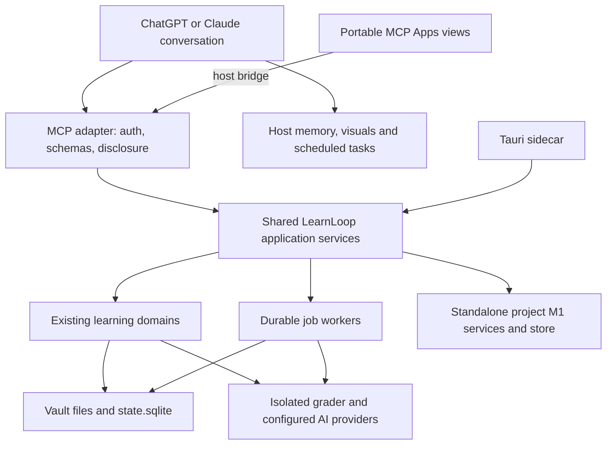

# LearnLoop in ChatGPT and Claude: MCP frontend (v1)

**Status:** proposed architecture and delivery specification; the production MCP adapter remains unimplemented. A separate synthetic M0 probe server is available (see below).

**Written:** 2026-10-13.

**Code baseline:** `9c3fe435d37f0c6dd845aabefb8b20b08ea47fb7` on the current checkout. Inspection began at `3e59d8770`; the intervening commit changes the Reader passage-check spend cap and generated references.

**Follow-up feasibility audit:** 2026-10-13, at `e238fa07a` (proof-alternative route checking and held-grade evidence fixes). This is a targeted delta/service audit, not a claim that every original matrix row was revalidated. The MCP/shared-application packages remain proposed. See §4.4 for host limitations, §8.4 for calendar/email/LMS use, and §12.3 for implementation work packages and live compatibility probes.

**Platform research:** official documentation and public example repositories, accessed 2026-10-13. Documentation support is distinguished from behavior verified in a connected account. Live connection observations and functional-probe limits are tracked below and in the linked results report.

**M0 probe setup (2026-10-13):** [runnable fixture and host prompts](../../scripts/mcp_probe/README.md), [results and limits](../reviews/mcp-compatibility-probes-2026-10-13.md). Eight backend cases and twelve SDK/HTTP cases passed, plus targeted file-schema/diagnostic checks. Both ChatGPT and Claude connect through a tokenized HTTPS endpoint on port 443, submit the exact two-line Unicode fixture, report stable retry receipts, and recover both host records in new chats. ChatGPT transferred the native 78-byte attachment after schema correction and exact-host approval; saved bytes and SHA-256 match. Claude's tested chat exposed inline text only. Both hosts' scheduled occurrence receipts arrived with the correct challenge, about 12s and 57s after their reported times; notification delivery and restricted task permissions remain unverified. External deadline handoff remains pending; Calendar/Gmail are connected in the owner's ChatGPT account, not Claude. The probe never loads a learner vault and does not establish production OAuth, actual grading or UI compatibility.

**Owner-directed next probe (2026-10-13):** defer Calendar handoff and prioritize personalization, prior-chat context and proactive conversational seeding. No calendar fixture was created. Three context/staging tools are deployed on the existing endpoint; the expanded suite passes 15 protocol cases. Their [host experiment](../../scripts/mcp_probe/PERSONALIZATION.md) remains unrun. These tools stage selected context for review; they do not yet invoke real vault or learner-model services. See §7.8 for production admission and algorithm implications.

**Reading guide:** §1 audits what exists; §4 proposes the service boundary; §5 maps feature coverage; §7 defines personalization and assessment; §8–9 cover native scheduling and UI; §12 gives implementation stages and gates.

## 0. Product decision

Make LearnLoop usable primarily through the learner's existing ChatGPT or Claude conversations. A remote MCP server exposes the learning workflows; small MCP Apps provide the controls and views that benefit from a stable interface. The chat host contributes conversation, personalization, project context, generated explanations and visuals, and supported scheduled tasks. LearnLoop retains the durable learning record and the authority to decide what an observation means.

The desired experience:

> “I have fifteen minutes. Continue the material that helps with my gesture project.”
>
> LearnLoop resumes today's finite plan. The host connects the topic to the project it knows, presents an appropriate question, and helps when asked. LearnLoop grades the submitted work, records assistance, and updates future practice. A later session in either host resumes from the same learning record.

This is a new delivery surface for the existing learning system. The project succeeds when a learner can do the normal capture → source → practice → feedback → repair → return loop without installing the desktop application, and when familiarity with their projects materially improves explanations.

**Retaining features means retaining their learning behavior and inspectability.** Screen layout, file browsers, and desktop administration need not be reproduced inside a chat. Section 5 makes the coverage and remaining dependencies explicit.

**Owner-confirmed direction (2026-10-13):** support both deliberate practice and learning woven into ordinary project conversations, with the latter a core product experience. The host should also be able to revisit an available question/response, identify a useful learning opportunity, and ask whether to add it to the vault to remember/maintain or develop further. An opted-in scheduled chat activity should proactively bring these opportunities and accepted learning goals back to the learner. This is part of the first useful product trial (§7.6, §8.3, J7).

**Activation refinement (2026-10-13):** spontaneous MCP invocation during ordinary
chat is optional. A dedicated host chat/workflow may periodically collate available
prior-chat learning context and offer remember/maintain/develop choices. Scheduled
check-ins should also be able to ask a useful question directly and continue when
the learner replies (§8.5–8.6). The first useful trial must not depend on ambient
tool invocation or complete history access.

**Primary conversational entry point (owner clarification):** most requests are
“explain this problem/concept.” Deliver the requested explanation directly, with
LearnLoop supplying relevant context and continuity. Hints, Socratic questioning
and assessments are optional modes; understanding a request must not require the
learner to attempt an answer first. See §7.9 and J9.

### 0.1 Design decisions proposed here

1. Use a Python MCP adapter over shared application services and the existing Python domains. Build portable UI resources in TypeScript/React.
2. Prefer a hosted, authenticated endpoint for everyday web/mobile use. Support a personal deployment of the same service; treat local stdio as a development/desktop option.
3. Preserve rich history, solutions and hints for teaching. Use purpose-specific disclosure for independent checks (§7), rather than indiscriminately returning the desktop DTO.
4. Keep grading and evidence updates in LearnLoop. Let the host personalize the instructional dialogue and generate exploratory visuals.
5. Keep the learning scheduler in LearnLoop; use host scheduling for invitations and reviews. Run durable backend jobs under LearnLoop's own worker lifecycle.
6. Accept small, relevant project briefs when needed. Host memory remains optional; the MCP server receives no automatic access to full chat history.
7. Ship an end-to-end experiment combining daily practice, project-conversation learning and proactive follow-up before expanding to the complete Reader and authoring experience. M1 supplies the reliable learning pipeline; M2 supplies the host strengths required for the first useful product trial. The later parity stages remain part of this proposal.

## 1. Evidence base and current architecture

### 1.1 How current behavior was established

Use code and merged commits to establish implementation status, and specs to establish intended contracts. A spec's “draft” header is not proof that its code is absent; a roadmap's “done when” row is not proof that its phases are merged.

Relevant recent commits:

| Commit | Architectural significance |
|---|---|
| `3ef44a8b5` | T6 source retrieval merged; follow-up `12b1ea122` unifies output budgets and adjusts retrieval/tutor behavior |
| `57d31c63b` | ChatGPT-plan provider merged; this is an isolated model transport, distinct from a chat frontend and its memory |
| `19798a0cc` | DL1 finite daily plan merged |
| `c1482f075` | Router R1, learner-text gaps, and facet identity composed onto main |
| `eb44a9009`, `eeccd4384` | EVSI calibration logging and its composition with router receipts |
| `c46b403c0`, `e01207d1f` | Reader workbench and adaptive-hint specification alignment; these commits do not implement all their phases |
| `c2bc09a49`, `3e59d8770` | RW1a inquiry workbench merged and its passage-check output budget composed |
| `9c3fe435d` | Latest inspected cap adjustment; use configuration, not a cap copied into this frontend |

At this baseline, the algorithm successor chain ends at `mvp-0.16` and the highest checked-in vault migration is `185_reader_authored_question_scopes.sql`. Older branch review notes mention different numbers. **Allocate future migration and algorithm versions at implementation time.** Each vault's configured version and kill switches determine its behavior.

### 1.2 Code-backed inventory

Paths below are evidence anchors, with the relevant symbols named to remain useful as line numbers move.

| Area | Current evidence | Consequence for MCP |
|---|---|---|
| Desktop transport | [server.py](../../src/learnloop_sidecar/server.py), [registry.py](../../src/learnloop_sidecar/registry.py), [client.ts](../../apps/learnloop-tauri/src/api/client.ts) | Tauri invokes a custom JSON-RPC sidecar. The registered methods are not already MCP tools |
| Runtime ownership | [context.py](../../src/learnloop_sidecar/context.py), `SidecarContext.load` | Loading a vault performs maintenance, state synchronization, worker binding and other work; it is not a passive read |
| Application orchestration | [practice.py](../../src/learnloop_sidecar/handlers/practice.py), [daily_plan.py](../../src/learnloop_sidecar/handlers/daily_plan.py), [teach_back.py](../../src/learnloop_sidecar/handlers/teach_back.py) | Some reusable workflow composition still lives in transport handlers and must be extracted carefully |
| Question presentation | [serializers.py](../../src/learnloop_sidecar/handlers/serializers.py), `practice_item_detail` | Includes `expected_answer`, hints, rubric, history and scheduler explanation; also snapshots assessment contracts and cold administrations |
| Finite plan | [engine.py](../../src/learnloop/daily_plan/engine.py), [chooser.py](../../src/learnloop/daily_plan/chooser.py) | DL1 is implemented; current chooser is `LaneQuotaChooser` / `lane_quota_v1`, with feasibility, minutes and explicit learner picks |
| Router | [router package](../../src/learnloop/router/__init__.py), [decisions.py](../../src/learnloop/router/decisions.py), [plan_log.py](../../src/learnloop/router/plan_log.py) | R1 logs decisions and outcomes; its package explicitly chooses nothing. R2's model block chooser remains a dependency, not a shipped feature |
| Grading/diagnosis | [blind_grading.py](../../src/learnloop/attempts/blind_grading.py), [post_attempt.py](../../src/learnloop/attempts/post_attempt.py), [worker](../../src/learnloop_sidecar/post_attempt_worker.py) | Blind grading is structurally separate from history-aware diagnosis; diagnosis work is durably enqueued after completion |
| Serving/submission identity | [practice handler](../../src/learnloop_sidecar/handlers/practice.py), [AttemptDraft](../../src/learnloop/attempts/attempts.py), [completion lock](../../src/learnloop/attempts/completion_lock.py) | Preserve submission recovery, offer binding, immutable assessment contract, completion and acknowledgment semantics |
| Exposure/measurement | [reveal_ledger.py](../../src/learnloop/attempts/reveal_ledger.py), [coldness_receipt.py](../../src/learnloop/attempts/coldness_receipt.py) | Receipts distinguish observed exposure, unknown channels, retrieval, repair attribution and held-out validation |
| Learner field | [types.py](../../src/learnloop/field/types.py), [outcomes.py](../../src/learnloop/field/outcomes.py), [placement handler](../../src/learnloop_sidecar/handlers/placement.py) | Reuse the predictor contract and observed/inferred/assumed distinctions; do not infer mastery from chat familiarity |
| Sources/tutoring | [source_retrieval/tutor.py](../../src/learnloop/source_retrieval/tutor.py), [reader handler](../../src/learnloop_sidecar/handlers/reader.py) | T6 already filters answer-leaking and assessment spans and records retrieval context; preserve these filters |
| Reader inquiry | [reader_inquiry.py](../../src/learnloop/reader/reader_inquiry.py), [ReaderScreen](../../apps/learnloop-tauri/src/screens/ReaderScreen.tsx) | RW1a exists: branches, resolution, reconnect, passage checks and activity. Its activity is explicitly salience-only |
| Project understanding | [projects package](../../src/learnloop/projects/__init__.py), [probes.py](../../src/learnloop/projects/probes.py) | M1 exists in a separate `projects/project_store.sqlite`; its probes do not write vault evidence. M2 integration must not be assumed |
| Capture/mobile | [capture domain](../../src/learnloop/capture/__init__.py), [mobile host](../../src/learnloop_mobile/host.py) | Reusable narrow capture domain; current mobile M1 is not a ready-made remote practice runtime |
| Generated media | [animation handler](../../src/learnloop_sidecar/handlers/animation.py) | Existing animation generation and polling can be reused; `llmedia://` delivery must gain an authenticated web equivalent |
| Persistence and boundaries | [table_roles.py](../../src/learnloop/db/table_roles.py), [pyproject.toml](../../pyproject.toml) | Raw ledgers, receipts, workflows and derived state have different ownership. Adapters remain independent; replay must not depend on frontend state |

### 1.3 Governing specifications and conflicts

Consume [daily-loop defaults](daily_loop_frictionless_defaults.md), [daily loop](spec_daily_loop_v1.md), [blind grading/diagnosis](spec_blind_grading_diagnosis_split_v1.md), [learner field](spec_learner_field_v1.md), [Slice A](spec_slice_a_practice_and_field_v1.md), [embedding consumers](spec_embedding_consumers_v1.md), [router](spec_action_router_v1.md), [Reader workbench](spec_reader_workbench_v1.md), [adaptive hints](spec_adaptive_hints_v1.md), [project understanding](spec_project_understanding_v1.md), and [mobile](spec_mobile_tailnet_v1.md).

The Reader spec references `spec_source_practice_and_probes_v1.md` on another development line. That file is absent from the inspected checkout. Treat its `find_sources`, `compare_sources`, valuation, and source-practice extensions as upstream dependencies. Existing T6 retrieval is available now; do not claim that the referenced APIs already exist.

The [ownership ledger](spec_ownership_ledger.md) also needs an explicit amendment when this proposal is adopted:

| Existing commitment | Proposed relationship |
|---|---|
| U-013@v2 interaction corpus | Consume the existing envelope; add transport provenance without treating activity as evidence |
| U-024@v1 randomized decisions | Preserve selection receipts and real propensities; host suggestions cannot impersonate a sampled policy |
| U-030@v1 desktop design language | Retain honest labels, disclosure and evidence distinctions; use host-appropriate visual components |
| U-031@v1 Tauri delivery surface | Propose MCP as an additional primary learner surface; keep per-phase fixture coverage |
| U-032@v1 inspectability | Preserve content/contract identities and accessible receipts in the MCP inspector |
| U-033@v1 reader dialogue | Reuse inquiry, exposure and disposition semantics |
| U-034@v1 reviewable authoring | Host-generated material enters the same proposal/admission pipeline |
| U-036@v1 non-text renderers deferred | This spec proposes a bounded delivery track for host visuals and MCP components; Reader RW5 owns verified mathematical figures |

This document does not silently change that ledger or mark its commitments implemented. Serving/evidence changes still follow the repository's successor and kill-switch discipline.

## 2. What the hosts provide

### 2.1 Documented capabilities and practical boundaries

These are capability observations, not a promise that every account supports every row. Preserve a dated compatibility record from actual account tests in M0.

| Capability | Documented support | LearnLoop design |
|---|---|---|
| Tool calls and inline apps | Both hosts support interactive MCP apps; the shared standard links tools to UI resources [E1–E3] | One core tool contract and portable components, plus small optional host extensions |
| Native figures | ChatGPT Visualizations supports interactive explanations with rollout differences [E4]. Claude custom visuals use HTML and currently render on web/desktop, not iOS/Android [E5] | Host creates contextual explanations; mobile receives a useful text/static or MCP component fallback |
| Persistent host artifacts | Claude artifacts can hold reusable documents, diagrams and interactive tools; availability of connectors/storage varies [E6] | Offer “keep this” for useful explanations; LearnLoop persists an adopted artifact's own content/version when durability is required |
| Personal context | ChatGPT memory and Projects; Claude memory, chat search and project-scoped context [E7–E9] | The host can personalize using context it actually has. The server cannot enumerate those memories or histories |
| Scheduled tasks | ChatGPT web tasks can use available connected tools/plugins [E10]. Claude scheduling supports connected tools; new cloud schedules can run while the computer is off, with legacy local-task exceptions [E11] | Read a due summary and invite the learner; verify the actual account's execution and notification behavior |
| ChatGPT panels and files | Optional sidebar apps, conversation panels, file viewers, deep links and desktop composer mentions [E12] | Reader and progress can request more space, with an inline/browser fallback |
| ChatGPT events | A documented webhook integration using draft MCP Events, limited to supported Work/cloud surfaces and a specified protocol version [E13] | Optional completion subscriptions later. Ordinary MCP tools and job polling remain sufficient |
| Files and external context | ChatGPT specifies file inputs [E14]; remote connectors provide their own authorized data access | Upload/import through a host adapter. A chat attachment or another connector's credential is not automatically accessible to LearnLoop |

Do not infer memory, scheduler, voice-tool access, or file-upload support from the presence of MCP Apps. Some are host/account features with no portable capability negotiation. Record them as **verified / unavailable / unverified**, and feature-detect protocol/UI capabilities where possible.

### 2.2 Lessons from other MCP products

The conclusions in the last column are design choices for LearnLoop, based on the public interfaces; they are not claims about those products' private infrastructure.

| Example | Publicly documented pattern | Adopt here |
|---|---|---|
| Notion MCP [E15] | Hosted MCP server uses the Notion API; OAuth exposes content the user can access | Put MCP over the application boundary; keep permissions and durable records with the product |
| Linear MCP [E16] | Centrally hosted Streamable HTTP, OAuth, distinct read-only endpoint/scope, tools for domain objects | A restricted review/reminder connection can avoid all practice mutations; expose recognizable domain operations |
| Official MCP Apps React example [E17] | Tool → `ui://` resource → iframe; React communicates through the host bridge; UI can bundle into one HTML file | Package small views independently of Tauri and keep their state recoverable from the server |
| Vercel Labs starter [E18] | MCP route and React widget are separate parts connected through the MCP Apps bridge | Keep a transport-independent presentation layer; a Next.js backend rewrite is unnecessary for this Python codebase |
| MCP Python SDK Apps documentation [E19] | Python can register UI-associated tools and resources | Use the Python SDK after pinning/testing its actual release and host compatibility; no Node proxy is required merely to serve React |

## 3. Standing contracts

- **MCP-1 — One learning record.** New chats, reconnects and changing hosts resume server state. Chat history and iframe state cannot be the only copy of an attempt, session or commitment.
- **MCP-2 — Purpose controls disclosure.** Solutions, hints and relevant prior attempts are legitimate teaching context. Independent checks have a narrower initial payload; every explicit reveal is accounted for.
- **MCP-3 — Blind grading remains structural.** Host memory, project briefs, prior attempts and personalized explanations never enter `BlindGradingContext`. An admitted question and rubric are item-side inputs; new personalized items follow authoring rules first.
- **MCP-4 — Authority remains typed.** Discussion, familiarity, reading, figure exploration, claims and diagnoses cannot directly mint demonstrated knowledge. Existing admission and effective-observation rules decide the effect of a submitted attempt.
- **MCP-5 — The learner controls help and direction.** Asking for a solution, choosing another item or stopping is supported. Its effect on assessment is recorded honestly.
- **MCP-6 — Preserve policy identity.** Selection candidates, algorithm versions, chosen-by fields and propensities survive transport. A host suggestion is advisory; an explicit learner pick is logged as such.
- **MCP-7 — Preview is not participation.** A reminder, job poll or plan preview cannot start a learner session, serve an assessment, reveal its answer, record study minutes or complete practice.
- **MCP-8 — Recover mutations.** Persist request identity and reconcile uncertain results before retrying. A lost network response must not produce a second attempt or second paid job.
- **MCP-9 — Replay stays offline.** Replay consumes persisted inputs and validated results, never host memory, chat history, model calls, generated UI execution or live connectors.
- **MCP-10 — Keep context bounded.** Personalization uses information relevant to the request. Saving reusable context is an explicit user action; a standing preference can authorize future updates within that stated scope.
- **MCP-11 — Honest fallbacks.** Missing memory, diagrams, scheduling, credentials or a backend phase has an explicit alternative. Unavailable functionality never appears as completed.
- **MCP-12 — Isolation is enforced by the service.** An authenticated principal determines vault access. Caller-supplied paths, user IDs, visibility annotations and UI state do not grant authority.

## 4. Target architecture



### 4.1 Proposed packages and extraction boundary

```text
src/learnloop_app/             # NEW shared use cases/runtime; above the domains
  runtime.py                  # vault lifecycle, leases, provider and worker ownership
  sessions.py, practice.py    # composition extracted from sidecar handlers
  plans.py, sources.py        # domain calls, no MCP/Tauri imports
  contracts.py                # typed commands/results, no UI protocol metadata
src/learnloop_mcp/             # NEW public adapter
  server.py, auth.py
  tools/                      # individual, discoverable tool definitions
  presentation.py             # purpose-specific model/UI payloads
  resources.py                # versioned UI assets and bounded content resources
  capabilities.py             # service features and tested host fallbacks
apps/learnloop-mcp-ui/         # NEW React views, host bridge, no Tauri APIs
```

These paths are proposed. Extract one use case at a time; both the desktop handler and the MCP tool call that service. Start with plan/session/practice and their completion path. Do not export `METHOD_REGISTRY` wholesale or import desktop handlers as the production MCP implementation. In particular, desktop handlers currently stamp `entry_surface="desktop_practice"` / `"desktop_teach_back"`; shared services must take a validated transport provenance value.

Add the new packages to import-linter. The dependency direction is adapters → application services → existing domains/infrastructure. The domains and replay cannot import either new adapter or the application layer. Keep the router R1 leaf contract and project M1 standalone contract intact. Move sidecar-specific worker supervision to the shared runtime when needed; preserve the existing durable diagnosis queue and completion pipeline.

### 4.2 Service deployment and concurrency

**Personal experiment:** one authenticated service and a copied vault on an always-on machine. ChatGPT can also use its documented private tunnel; Claude remote connections originate in its cloud and need a reachable endpoint [E20–E21]. A tailnet-only mobile host does not automatically satisfy that requirement.

**Hosted pilot:** one isolated vault directory and runtime owner per learner/vault, including its SQLite database and originals. A small control store maps authenticated accounts to authorized vaults and encrypted provider credentials. Requests attach to the right runtime; never share a mutable process-global `SidecarContext` across users. Keep SQLite on local durable storage, use backup-API snapshots, and serialize conflicting vault mutations through the runtime while preserving existing database constraints and completion locks. Workers use their own connections and bounded leases. Multi-host distributed SQLite writes are out of scope.

The primary runtime owns migrations, upgrade/rebuild, startup maintenance and worker activation. Read-only/reminder requests attach without triggering them. Database transactions remain short; waiting for remote model results cannot hold a global write lock. Durable jobs bind to a vault and input revision so restart/retry cannot apply a result to a changed question or another vault.

**Timezone is required for hosting.** `daily_plan.engine.local_date` and repository streak/report helpers currently use the process's local timezone. Introduce an explicit account/vault IANA timezone through a shared calendar service, including plan boundaries, streaks and reminder deduplication. Do not change process `TZ` per request. Preserve UTC event timestamps; record timezone revisions and apply a changed zone prospectively, without rewriting previous plan dates.

Local and hosted vaults require an explicit migration/import/export flow. The first release has one authoritative location for a vault; simultaneous local/cloud file synchronization is a separate project.

### 4.3 Protocol and authorization

Use authenticated Streamable HTTP at `/mcp`, with SDK-supported negotiation and a tested compatibility matrix. Pin the Python SDK and MCP Apps bridge versions together in M0. Current docs span protocol generations; the optional MCP Events integration's newer requirements do not establish universal client support. Keep event support isolated from the ordinary tool path.

Implement OAuth discovery and token audience/scope validation according to the pinned MCP authorization specification [E22]. Suggested service scopes: `learning:read`, `practice:write`, `sources:write`, `context:write`, and the narrow `reminders:write` for delivery leases. Account/vault selection is a server authorization decision. A transport session ID is never an access token.

Every public operation has its own tool name, input/output schema and accurate read/write, destructive, open-world and idempotency annotations. Avoid a generic `call_rpc`, `execute`, SQL, shell or arbitrary vault-file tool. A “get” name is not proof of read-only behavior. OpenAI's tool-independence and input-minimization requirements inform this interface [E23]; required functionality must work without instructing the model to call another plugin.

Use the MCP Apps resource/bridge standard for portable UI. Host-specific file input and display extensions are optional adapters. Tool visibility controls presentation/discovery, not authentication. Answer keys do not become safe assessment payloads merely by putting them in UI-only metadata.

### 4.4 Feasibility: service capability versus host capability

The core learning workflows are implementable over authenticated MCP tools and optional MCP Apps. The complete product additionally requires LearnLoop's durable backend, host workflow instructions, tested scheduled tasks, and a small authenticated web surface for upload/Reader fallback. A bare endpoint alone cannot provide every proposed interaction. The matrix is an architectural assessment; the dated M0 results separately identify observed host behavior and remaining limits.

| Feature | Feasibility assessment | Implementation boundary / fallback |
|---|---|---|
| Practice, history, decisions/embeddings, grading and cross-host resume | Supported architectural fit | Domain operations and durable handles work through tools; implement service extraction, identity and recovery. |
| Inline practice, feedback, progress and source views | Documented MCP Apps support [E1–E3] | Build actual components and test each surface. Text and authenticated browser views cover missing/limited rendering. |
| Personalized explanation using host context | Conditional on available host context | Return bounded teaching context; host uses memory/projects when enabled. LearnLoop cannot read private host memory directly. |
| Retrospective review of available chat exchanges | Host-mediated, bounded | Host chooses/retrieves available context and submits a selected opportunity. Claude documents scoped chat search [E9]; this is not a portable server history API. |
| Guaranteed capture of every message across all chats | Unsupported by a plain MCP endpoint | Tools run when the host invokes them [E30]. No documented universal message-observer hook was established. Optional skills/instructions improve workflow recall, but cannot guarantee capture. Complete coverage would need a separately supported export/instrumentation integration. |
| Automatic invocation whenever any topic becomes relevant | Best effort | Accurate tool descriptions and optional host skills [E31] help discovery. Explicit activation and a scheduled review are the dependable product entry points; measure missed/irrelevant suggestions. |
| Transfer user attachments into the vault | Documented ChatGPT path; portability unproven | ChatGPT provides declared file inputs and temporary download URLs [E14]. Equivalent automatic transfer of Claude conversation attachments was not established in this audit. Provide a scoped LearnLoop upload page or pasted excerpt/link fallback; test before advertising one-step capture. |
| Reuse native diagrams/artifacts | Conditional | Discussion/rendering can work; durable adoption requires actual exportable content. A host visual without accessible bytes stays a reference or reported event. Use an instrumented LearnLoop component for reliable interaction records. |
| Video understanding | Partial portable support | Timestamped captions/transcripts and supplied frames are viable; whole audiovisual access is neither uniform nor implied by a URL [E25, E27]. Reuse existing ingest/transcription where applicable. |
| Scheduled study and opportunity review | Documented host capability, account-dependent [E10–E11] | ChatGPT web tasks can use connected tools/context; Claude scheduled runs are their own sessions. Persist required LearnLoop context and test custom connector access, approvals and notifications in the real accounts. |
| Backend push into a chat | Host-specific extension | ChatGPT documents subscribed MCP webhook events in supported Work surfaces [E13]. No equivalent portable unsolicited-message mechanism or Claude equivalent was established. Use scheduled pulls and resume links as the baseline. |
| Reuse other host connectors | Host-mediated composition | The host can pass selected authorized facts to LearnLoop. The MCP server receives neither those connectors' credentials nor permission to call them. A guaranteed independent sync needs a separately authorized direct integration (§8.4). |
| Grade or run decision models through the user's chat model from inside a tool | No portable contract established | Retain provider routes/credentials. Do not rely on optional MCP sampling; it is deprecated in the newer protocol guidance [E32]. |
| External context changes latent learner state | Domain/algorithm work, not a protocol limitation | A transport can carry typed observations. Their admissibility, correction, weighting, replay and evaluation need explicit domain rules (§7.7). |

Host packaging should include concise, optional workflow instructions for deliberate practice, current-chat capture, retrospective opportunity review and follow-up. ChatGPT documents skills complementing MCP tools [E31]; use the supported equivalent on each Claude surface only after verification. A project instruction or saved task prompt is a fallback. The tool descriptions stay self-contained and accurate. Do not treat a prompt, a model promise or a widget message as an always-running listener.

Pin and test protocol versions rather than equating SDK support with host support. The newer MCP specification changes transport sessions and server-to-client interactions [E32]; keep LearnLoop session/presentation identity explicit and durable regardless of the negotiated transport. Do not make Events, protocol Tasks, sampling or elicitation prerequisites for ordinary practice. Application job handles and `get_job` remain the portable recovery contract.

## 5. Feature coverage

Milestones M0–M5 are defined in §12. “Reuse” means reuse the domain behavior after extracting any handler-owned composition; it does not mean the remote version already exists.

| Learner workflow | Current foundation | MCP experience | Delivery / dependency |
|---|---|---|---|
| Connect, create/import vault, resume | Vault loader, profiles, sessions | Connect account, select/create vault, resume current work without onboarding forms on each visit | M1; hosted account setup is new |
| Finite daily plan, minutes, re-entry, streak | DL1 plan engine and session services | “I have ten minutes”; compact plan card; stop/keep going; truthful completion | M1; explicit hosted timezone |
| Ordinary practice and “I'm stuck” | Practice handler and `AttemptDraft` | Exact question presentation, chat or widget answer, confidence if requested, stuck/skip | M1 |
| Feedback, grading clarification, correction | Feedback handler, grade/regrade and clarification domains | Criterion evidence, smallest repair, unresolved/incorrect-grade action; asynchronous diagnosis status | M1 core, M3 full correction controls |
| Diagnostic probes and repair | Probe contracts, causal repair, guided redo, cold receipts | Stateful probe dialogue, help transition, repair practice, later independent check | M3; no flattened ordinary-Q&A substitute |
| Teach-back and transfer | Teach-back state/turn handling | Natural dialogue with persisted learner and examiner turns; final grade through existing pipeline | M3; host-generated examiner turns require a validated extension, described in §7 |
| Goals, intent, placement | Goals, commitments, placement self-reports | “Prepare for my exam”, “maintain this”, “I know this”; preserve assumed versus demonstrated labels | M3; broader DL2 intent behavior waits for its owner |
| Practice families and variants | PF generation, verification, index, coverage | Find practice; request a project-relevant variant; admit verified content before scoring | M3 |
| Capture from conversation, URL, image | Capture inbox + media/originals | “Keep this”; save first, optional practice adoption later; no inbox debt counter | M2; automatic solving/adoption beyond current capture uses upstream DL phases |
| Import/outline/study maps | Ingest jobs, selections, build plans, proposals | Import attached source, choose scope in a compact outline, inspect costs/proposals, resume job | M3 |
| Source reading and citation navigation | Reader render/PDF/span APIs, annotations | Source card, larger Reader pane, exact revision/span links and return-to-passage | M3; browser Reader fallback is required |
| Branching inquiry and reconnect | RW1a | Ask about a passage, detour, return, “still unclear”/quick check, saved inquiry state | M3 |
| Source-grounded tutoring | T6 retrieval, reader/tutor modes | Host explains from allowed passages, distinguishes quotation/inference/project analogy | M2 basic, M3 complete Reader integration |
| Rich workbench/adaptive hints | RW2 and adaptive-hint specs | Resumable work, step checks, help ladder, “that didn't connect” and learner-route support | M4 as upstream services land; current authored hints remain available |
| Library comparison and source-derived probes | T6 exists; expanded sources track referenced but absent | Search now; preserve source disagreement; verified source exercises/probes later | M3 existing search; M4 upstream extension |
| Exploratory diagrams and simulations | Native host generation | Explain using sliders, plots, graphs and project examples; useful with zero custom renderer code | M2; capability fallback and correctness labels |
| Saved/verified figures and animations | Existing animation jobs; RW5 figures proposed | Reopen adopted figure, inspect assumptions, record a prediction before revealing result | M4; RW5 owns formal figure verification |
| Progress/knowledge map/“why this?” | Knowledge map, facet evidence, capability grid, forecasts | Inline summaries; expandable graph/field; source and attempt drill-down | M3; no invented mastery from host memory |
| Project comprehension | Standalone projects M1 | List due project probes, answer from memory, inspect explanation in a focused view | M3 isolated adapter; vault evidence/daily-plan incorporation waits for project M2 |
| Exams and golden-path assessment | Exam sessions, blueprint/golden-path services | Stable assessment component or authenticated browser view; defer feedback as current sitting requires | M4; limited guarantees in an open tutoring conversation |
| Authoring, editing, retirement, graph proposals | Item authoring, proposals, graph edit | Draft, inspect diff, accept/reject, retire with reason, undo where supported | M3–M4 |
| Claims, adjudication, calibration and inspection | Claims, adjudication, measurement and inspector handlers | Focused advanced views with bounded tools and receipts | M4; keep machine/admin operations outside the public tool set |
| Reminder and weekly review | New host workflow over existing summaries | Native scheduled invitation and progress review; quiet when done | M2 |
| Calendar/email/coursework preparation | Existing goals/deadlines and commitments; no general connector-sync service | Host supplies bounded assignment/event facts; propose preparation and follow-up, reconcile revisions | M2 narrow supplied-context pilot; M3 broader J8; direct provider sync separate |
| Voice and handwritten work | Host input capabilities; photo-answer track proposed | Dictation/capture when supported; reviewed transcript/image interpretation before formal submission | M5; no universal MCP-in-voice claim |
| SQLite console, arbitrary CLI/file editing, local provider secrets | Desktop administration handlers | Operator CLI/local administration or a separately scoped management interface | Intentionally outside learner MCP parity |
| Offline use and OS integrations | Local Tauri/filesystem | Personal/local deployment where supported; export remains available | Networked chat cannot promise desktop offline parity |

Before retiring a desktop learner workflow, complete its matrix row and demonstrate its failure/recovery path. M1 is a product experiment, not a claim of full parity.

## 6. Tool and data contracts

### 6.1 Initial tool surface

These are proposed public names. An implementation may refine names before publication, but must preserve their separate effects. Additional domain tools are registered individually as parity phases ship.

| Tool | Effect and required behavior |
|---|---|
| `learnloop_get_status` | Read capability/version/provider readiness, without loading a mutating desktop runtime or returning credentials |
| `learnloop_get_today_summary` | Read a projection of remaining work, preferred minutes and completion; no serve, plan materialization or learner activity |
| `learnloop_start_session` | Start/resume a finite plan under an idempotency key; optional minutes and explicit learner intent |
| `learnloop_open_next_activity` | Atomically bind the next eligible offer and its presentation; supports practice/reading/stop outcomes |
| `learnloop_choose_activity` | Explicit learner pick from an authorized offer; preserve `learner_pick`, never claim policy propensity |
| `learnloop_save_answer_draft` | Save the exact learner draft against its presentation revision; no grading |
| `learnloop_submit_answer` | Persist/recover one submission; run the canonical grade/completion pipeline; return a result or durable operation reference |
| `learnloop_get_submission` | Recover commit/grade/diagnosis status, the saved learner answer and result references; no solution/repair disclosure or re-grading |
| `learnloop_request_hint` | Deliver a hint and record its assistance through the shared help/reveal rules |
| `learnloop_reveal_solution` | Explicit solution disclosure with the corresponding reveal and purpose transition |
| `learnloop_get_feedback` | Display feedback, including existing exposure accounting; this may mutate delivery records and is annotated accordingly |
| `learnloop_skip_activity` | Record skip/stuck disposition as the current domain requires; do not invent an incorrect answer |
| `learnloop_end_session` | Persist session completion and concise summary |
| `learnloop_extend_session` | The learner's explicit “keep going” action |
| `learnloop_get_learning_context` | Bounded teaching context for named topics: relevant prior attempts, typed hypotheses and preferences; obey active assessment reservations |
| `learnloop_get_job` | Read an operation's actual status and safe result references |

M2 adds separate `learnloop_capture`, `learnloop_search_sources`, `learnloop_get_teaching_material`, `learnloop_record_assistance`, `learnloop_save_project_brief`, `learnloop_revise_project_brief`, `learnloop_remove_project_brief`, `learnloop_get_reminder_recipe`, and `learnloop_claim_reminder` tools. A capture is a saved reference; a later adoption command must be distinct from saving it.

M2 also adds the learning-opportunity workflow (§7.6): separately defined list, propose, accept, defer and dismiss operations. Proposed names are `learnloop_list_learning_opportunities`, `learnloop_propose_learning_opportunity`, `learnloop_accept_learning_opportunity`, `learnloop_defer_learning_opportunity`, and `learnloop_dismiss_learning_opportunity`. Proposal persistence requires an authorized capture scope; otherwise the host presents the suggestion in conversation first. Acceptance binds the candidate revision and the learner's chosen intent. It may orchestrate capture and an existing commitment/adoption service, with separately recoverable outcomes. It cannot acknowledge scheduled practice until that downstream state exists.

M2 scheduled interaction adds `learnloop_prepare_check_in` (idempotent creation of
a bounded question/proposal packet under an opted-in schedule),
`learnloop_get_check_in` (read/recover), and `learnloop_respond_to_check_in` (save an
exact response or explicit disposition and return its typed domain route).
Assessed answers still use `learnloop_submit_answer` against a valid presentation;
the check-in response tool must not become a second grading implementation.
These are proposed production tools, not tools present in the compatibility server.

M3–M4 add individually described tools for the matrix rows: source imports/selections, proposals, reader inquiries/annotations, teach-back turns, diagnostics, goals, progress, project probes, corrections and assessments. Do not introduce an undisclosed generic executor to keep the visible list short. Resource links and compact contextual results limit token use; host tool search may help discovery but is not a prerequisite.

### 6.2 Presentation and submission identity

The service issues a `presentation_ref` bound to:

- authenticated vault, session and current activity;
- item/surface version and assessment contract;
- scheduler candidate/offer and probe presentation, where applicable;
- permitted purpose and assistance state;
- workflow revision and terminal status.

The host round-trips this opaque reference. The server resolves the underlying identities; it does not trust caller substitutions for candidate, contract, purpose or evidence origin. A question must use the existing structured **presentation blocks**, not just `item.prompt`, so practice-family stimuli and other required information are retained.

Illustrative model-visible response (wire schema `mcp_practice_v1`):

```json
{
  "schema_version": "mcp_practice_v1",
  "presentation_ref": "p_opaque",
  "revision": 1,
  "purpose": "practice",
  "presentation": {"blocks": [{"kind": "markdown", "text": "..."}]},
  "response_format": "markdown",
  "assistance": {"recorded": false, "outside_chat_help_observable": false},
  "available_actions": ["submit", "hint", "solution", "skip"],
  "plan": {"estimated_minutes_left": 12}
}
```

Only workflow references needed for the next action are model-visible. Debug IDs, raw provider logs, internal paths and detailed receipts belong in an explicitly opened inspector. UI-private metadata may carry view state; it must not contain hidden solutions for an independent check.

Submission contains `presentation_ref`, `expected_revision`, a stable `submission_key`, exact `answer_md`, and optional explicitly requested confidence/justification fields. A direct widget preserves what the learner typed. A chat submission is recorded as `chat_relay`; it must not be represented as cryptographic proof that the model copied the human verbatim. Show the stored answer in feedback and support correction through the existing correction/regrade path. Missing optional justification is legitimate.

Same key + same payload returns the original operation/result. Same key + different payload returns `idempotency_conflict`. Another submission against a consumed presentation returns its terminal state. Scope keys to principal/vault. Bind a draft's identity before a network retry, and keep the existing submission acknowledgment separate from grade completion.

Two chats must not independently advance the same plan cursor. Compare-and-swap the plan/presentation revision when opening, skipping or submitting. An explicit resume returns the current presentation; a superseded card offers recovery. A deliberate second activity uses a distinct session/presentation and still observes shared vault reservations. Model or UI retries cannot turn a stale cursor into a new learner pick.

### 6.3 Slow work and errors

Grading remains logically before final feedback/evidence completion. If it outlasts a host call window, return `pending` with a durable operation reference; a worker continues the same immutable submission. This is asynchronous transport, not permission to show a provisional grade as final. Diagnosis remains its separate post-attempt job.

**Post-baseline grade holds:** preserve the mvp-0.17 proof-route check and [held-grade predicate](../../src/learnloop/held_grades.py). Operation completion and grade admissibility are separate fields. A successfully executed operation can yield a grade held for review; surface its resolution path without counting its provisional score as success, failure, a learner observation or an FSRS review. Regrade/owner resolution must use the shared predicate and replay semantics. Add held-to-released and scored-to-held recovery cases to G1/G8.

Operations have `queued | running | awaiting_learner | succeeded | failed | cancelled`, input revision, result reference and safe retry information. Existing domain jobs keep their own semantics; the MCP operation envelope tracks/recovers them rather than creating a competing queue. Where a domain operation lacks durable execution, add it before advertising resumability.

Status reads return safe state and authorized result references, not raw worker outputs. Full grading feedback, solution artifacts and generated practice references go through their disclosure/delivery operation even when fetched after completion. This prevents `get_job` or recovery polling from becoming an unrecorded answer-reveal route. Cancellation after a grade commits stops subsequent optional work only where the domain supports it; it does not erase the committed attempt.

Error codes include `auth_required`, `scope_denied`, `stale_presentation`, `already_submitted`, `idempotency_conflict`, `provider_unavailable`, `budget_exhausted`, `needs_clarification`, `source_unavailable`, `vault_upgrade_required`, and `unsupported_capability`. Return whether the operation is known committed, known uncommitted, or needs reconciliation. A dropped connection does not imply cancellation. Retry/poll uses the same operation reference with backoff; the UI must not poll an expired or superseded operation forever.

### 6.4 Content resources and media

Serve versioned UI resources such as `ui://learnloop/practice/v1.html`, plus Reader, progress, feedback and proposal resources. Semantic content references identify immutable source revisions/spans and adopted artifact versions. Also expose ordinary tools to retrieve bounded content: clients differ in how they use MCP resources.

Import a host attachment while its authorized download is valid, record its content hash and immutable source revision, and retain the original according to the vault's rules. Never make a temporary host URL the durable source identity. The existing `llmedia://` and local-file paths must be translated into scoped, expiring web asset access or resource delivery. Support PDF byte ranges and citation navigation in the web Reader; do not send a whole textbook into a tool result to render one page.

## 7. Personalization, tutoring and trustworthy attempts

### 7.1 Rich tutoring context is a feature

Previous attempts, solutions and hints are not inherently inappropriate to send to the host. Teaching often benefits from all three. The distinction is between **what helps the assistant teach** and **what LearnLoop can claim about an independently produced answer**.

| Situation | Host can receive | Required handling |
|---|---|---|
| Explain or review a concept | Relevant previous work, grades, typed diagnoses, source passages, solutions and hints | Distinguish demonstrated facts from hypotheses; record instructional exposure where mapped to LearnLoop material |
| Assisted practice | Current draft, selected help, useful earlier work and reference solution when requested | Record assistance and use existing effective-observation/FSRS treatment; preserve the learner's actual answer |
| Independent or delayed check | Exact stimulus, necessary instructions, response format; purpose-appropriate source label | Initially withhold answer, hints, answer-bearing rubric details, previous solution and revealing rationale |
| Feedback after submission | Answer key, criterion evidence, repairs, relevant history and personalized explanation | Preserve feedback/reveal accounting, including later reopens |
| Blind grading | Current submitted answer and the admitted item-side grading contract | Isolated backend call; no host memory, learner-history context or personalized coaching |

Normal non-revealing learning goals or rubric criteria may be useful before an answer. Disclosure is decided by the item/purpose contract, not by banning the word “rubric.”

The initial independent-check path must not call `practice_item_detail` and then drop a few fields: that serializer has side effects and its nested structures may disclose answers. Extract explicit prepare/open/read projections. Apply the same disclosure policy to source search, inspection, feedback, preview and other routes that could reveal the reserved surface. If the learner asks to see it, transition to supported help and record the disclosure; do not make learning inaccessible to protect a metric.

### 7.2 Three personalization paths

**Host-only personalization, default.** LearnLoop returns the learning target, source-grounded explanation material and appropriate learning history. The host connects them to its available memory/project context and the current conversation. No context import is required. Instructions encourage a concrete connection when useful and allow a plain explanation when no connection is known.

**Task-specific application context.** A generation/retrieval tool may accept a short `application_goal` and relevant constraints, for example “understand change of basis for the camera/world transform in this project.” This can guide an explanation or propose a practice variant. It cannot silently rewrite a question already served under a frozen assessment contract. No `all_memories`, full transcript or accumulated prior-turn array is accepted [E23].

**Saved project brief, explicit.** The learner can say “Use this project for my linear algebra practice.” Persist a small, editable record:

```text
ProjectBriefV1
  id, revision, title
  objective, relevant_concepts, application_constraints
  source_refs[]                 # artifact/repo/document revisions when available
  origin                       # learner_statement | host_summary | imported_artifact
  verification                 # unverified | learner_confirmed | source_grounded
  captured_at, last_confirmed_at, supersedes
  allowed_uses[]                # explanations | practice_proposals
```

This is a proposed application-context record, separate from the existing repo-enrollment/project-probe store. It is not a second learner mastery profile. Use existing source/proposal primitives where they fit; add a versioned store only for the missing context lifecycle.

Transient context is request-scoped. Save only what is needed in receipts for a persisted generation decision; document that retention separately from a reusable brief. The host may not provide a stable project/chat ID or a memory citation: mark origin accordingly instead of inventing one. Old briefs can be used for optional examples, but stale goals/deadlines require reconfirmation before affecting commitments. Contradictions prefer the learner's current correction and preserve the revision trail.

Changing or removing a brief stops future personalization from it. It does not alter historical graded items or silently delete audit records; account data deletion/export is handled explicitly. A new host receives only the saved brief and authorized LearnLoop state, not the other host's private memories.

### 7.3 Project connections beyond memory

The host can use context already available from a project, an uploaded artifact or another authorized connector to explain an application. LearnLoop tools must also work when none of these exists. Do not require another connector in a tool description or assume permission to traverse it.

For source-grounded practice, selected artifacts must enter LearnLoop with an immutable revision and provenance. An analogy based on a host recollection stays an analogy until grounded. Source authority remains explicit: user notes, canonical teaching material, generated explanation and assessment-only material have different roles.

Repo comprehension uses the existing project M1 services and separate store. A hosted MCP service cannot sweep a laptop's repositories: use the existing local capture agent with an authenticated upload extension, or a separately authorized repository integration. First expose M1's due/open/respond/grade/report behavior. Integrating those probes into the vault plan and evidence is project M2's work, including its import rules; a new MCP tool must not bypass it.

### 7.4 Assistance and the limits of observability

Record service-delivered hints, solutions, source passages, guided redo and feedback through the existing reveal/exposure mechanisms, with a versioned transport basis. A native host explanation can be reported as assistance when the host calls `learnloop_record_assistance`; persist its origin and whether content was captured. That call is useful telemetry, not a guarantee that every host utterance has been observed.

Keep unknown channels explicit: host-generated text/figures, unreported chat help, previous conversation context, external browsing and the working tree. Delivery to a model and actual display to the learner are different events. Record known delivery, instrument widget rendering where possible, and never infer that a returned component was read. A reveal transaction precedes returning the revealing material; failed delivery remains distinguishable from an acknowledged display.

Use existing `coldness_receipt` qualification logic and its scoped absence claims. **Do not turn every unobserved channel into a new hard failure**, and do not silently upgrade unknown to pass. Changing eligibility or evidence weight requires its own successor/admission design. The first release labels the available evidence and telemetry honestly; strict assessment may use the focused web/component path to reduce observable assistance, while still acknowledging external help cannot be ruled out.

A fresh chat is helpful for reducing conversational carryover but does not prove absent memory or prior exposure. A widget is helpful for capturing the exact answer but does not prove unaided work. Host model output cannot self-assert `evidence_origin="human"`, a qualifying cold receipt, a grade or a policy propensity.

### 7.5 Dialogue orchestration

For teach-back and probe dialogues, retain canonical turn order, stopping conditions, answer identities and the final grading route. Initially let the existing service select examiner questions; the host presents them and personalizes surrounding discussion without modifying the scored question. A later host-driven examiner mode must persist the exact question, validate the allowed turn/target, and declare changes in the task contract before it can contribute comparable evidence.

Do not run two full tutors for every exchange. In ordinary teaching, the host uses a bounded LearnLoop context/source tool and writes the explanation. Use the existing backend tutor when its constrained mode, retrieval verification, or help policy is required. Any model-generated content adopted into canonical practice goes through verification and authoring admission regardless of which model wrote it.

### 7.6 Retrospective learning opportunities and conversational seeding

This is a core owner-requested workflow. During a project conversation, or when revisiting context the host can actually access, the assistant may notice a question, a useful explanation, an unresolved difficulty or a skill the learner would benefit from retaining. It offers a concrete suggestion:

> “The camera/world transform discussion could be useful to revisit. Would you like to keep the explanation, remember the key ideas, or develop fluency applying it?”

The learner can choose **save as reference**, **remember/maintain**, **develop the skill**, **later**, or **dismiss**. These are proposed presentation labels over existing capture, commitment/depth and goal services. The adapter must map each label to supported domain semantics and expose missing upstream dependencies. Remember/maintain expresses the desired future retention; it does not assert that the learner already knows the material. Skill development may require placement, sources or an admitted practice proposal. Neither selection creates a fabricated past attempt.

The host first reasons over context available to it. It sends LearnLoop only the relevant excerpt/summary and a bounded proposal. Looking back within the current chat is distinct from searching other conversations; cross-chat retrospective review is supported only where the host actually provides authorized access. No full-transcript synchronization or portable chat-history API is assumed. Missing source-message IDs are recorded as unavailable; an assistant paraphrase is labelled as such.

Proposed `LearningOpportunityV1` workflow data:

- candidate ID/revision and idempotency identity;
- topic, proposed skill/application and a short reason for revisiting it;
- selected learner quotation and assistant explanation, separately attributed, or a labelled summary;
- source refs/message refs when available, capture time and original event time if known;
- known assistance/source exposure, uncertainty and verification status;
- proposed intent, candidate links to existing topics/commitments and separately labelled model interpretation;
- status (`proposed`, `deferred`, `dismissed`, `accepted`), defer time and accepted capture/commitment/adoption result refs.

This is a proposed workflow record, with storage roles assigned under §10.1. It seeds content, intent and possible diagnostics. Further latent-state effects require explicit admission through the existing learner-text-gap/inquiry/evidence services; free-form assistant judgments do not become numeric mastery updates. An old exchange with unknown assistance remains usable learning material even when it cannot support an independent assessment claim. Generated explanations retain their provenance and undergo the ordinary verification path before adoption as canonical practice.

Before the learner accepts, suggestions may remain only in the host conversation. If the learner opts into a standing capture/review scope, bounded pending proposals may be persisted for later review under that scope. Saving a pending proposal does not create a commitment. Persist exact topic/intent acceptance and revisions; retries converge on the same capture and downstream adoption request. Similarity can nominate an existing topic for reuse, but uncertain matches must not silently merge learning goals. Support correcting the topic, changing the desired depth, deferring and dismissing without a backlog/debt counter. Dismissal suppresses repeat suggestions for that candidate unless the learner reopens it or materially new context warrants a new proposal.

Acceptance can authorize the ordinary required capture/adoption steps together. Reuse an existing suitable follow-up schedule; otherwise offer one concise schedule setup using the user's established preferences. Saving content alone does not authorize recurring notifications. A persisted opportunity, accepted intent, admitted practice and confirmed external schedule each have their own truthful status.

### 7.7 External sources, multimodal context and learner signals

Useful context can originate outside the vault. Start with bounded host-assisted capture using the existing text/URL/image inbox and the opportunity contract in §7.6; a whole-source import is optional. These are proposed extensions, not claims that every host can hand its attachments or tool outputs to an MCP server.

| Opportunity | Initial experience | Capture and capability boundary |
|---|---|---|
| Selected webpage passage or cited link | “Connect this to what I am learning” or “Remember this idea” | Preserve URL/title, selected excerpt and access time when available. Claude documents web fetch [E28]; supported ChatGPT browser surfaces can use selected text and tabs [E25]. Host access to a signed-in page does not transfer its session to LearnLoop. |
| Screenshot, photograph, diagram or handwritten draft | Discuss a visual, identify a difficulty, propose practice | Both hosts document image inputs [E26–E27]. Save the actual image through supported attachment delivery when authorized; otherwise retain a labelled host interpretation with `original_unavailable`. Learner-work attribution and transcription review are required before a formal submission. |
| Paper figure or document section | Explain a bounded section and relate it to existing concepts | ChatGPT documents file input [E29]. Claude documents visual PDF processing within its limits, and text-only handling for other document formats [E27]. Keep page/figure references and distinguish extracted text from visual interpretation. |
| Lecture/video segment | Save a useful idea or question at a timestamp | ChatGPT's supported browser side chat can use timestamped YouTube captions [E25]. This establishes a transcript path, not complete audiovisual understanding. Use supplied transcripts and selected frames as the portable fallback; store which channels and time ranges were actually available. Full-video extraction is a separate ingest/worker capability. |
| Code, errors or a data-analysis result already discussed | Identify a transferable concept behind the current task | Save the relevant snippet, learner contribution and result provenance. Assistant-written code or an assistant-executed calculation cannot stand in for learner performance. Host file/tool access and source revision availability are tested separately. |

**Lightweight source context:** extend the opportunity's source attachment metadata, reusing capture/source primitives where possible. Carry source kind and locator, available page/time/region anchor, actual excerpt/image/artifact ref or a labelled summary, speaker/author attribution, capture time, original-content hash when bytes were captured, extraction method, coverage (`text`, `transcript`, `selected_frames`, etc.), verification status and availability (`captured`, `external_reference`, `host_summary_only`, `unavailable`). Preserve transformations: sanitized image bytes, crops, OCR and summaries are derivatives with their own identity. An inaccessible or mutable URL cannot substitute for a saved immutable original. Accept sparse records with explicit unknowns; do not ask the learner to fill a metadata form.

The MCP server receives only what an authorized tool call transfers. A host having viewed a file, page or video does not guarantee that LearnLoop can retrieve it later. Capture reusable content while a supported attachment URL remains valid; otherwise save a link/summary with its limitation. Subsequent import upgrades source availability while preserving the earlier record and derivation. Scheduled review uses saved context when host originals are unavailable.

**M0 observation:** both initial chats could discuss the synthetic attachment but exposed no download URL. After correcting ChatGPT's file-input schema, refreshing tools and approving the observed download hostname, ChatGPT transferred the actual 78-byte fixture; saved bytes and SHA-256 match. Claude's tested chat still exposed only inline text. Retain a direct upload fallback for immutable originals and explicit host-extracted text/summary capture with provenance. A host file ID or local sandbox path alone is not an importable source. Preserve a lightweight opportunity when original-file capture is blocked, without claiming the original was saved. Image/PDF/video transfer, large files and URL-expiry handling need separate tests.

**Relationship to the learner model:** source content supplies topics and teaching material; learner behavior supplies observations about the learner. Track the distinction explicitly:

| Signal | Permitted initial use |
|---|---|
| External concept resembles an existing topic | Suggest a connection or explanation; embedding similarity nominates candidates, with existing judging/selection rules before consequential adoption |
| Learner explicitly wants to remember or develop it | Accepted commitment/goal through the §7.6 workflow |
| Learner asks a question | Topic relevance and requested explanation depth; optional retention/expansion proposal; no presumed gap (§7.10) |
| Learner explicitly names a difficulty | Typed learner-reported observation; propose a diagnostic or use an applicable existing learner-text-gap service with its admission rules |
| Host infers a misconception or missing prerequisite | Provisional hypothesis with provenance and correction; schedule a confirming question through supported policy |
| Learner explains, predicts, solves or debugs something | Candidate performance trace; retain actual task, learner contribution, assistance and result before admission to an appropriate evidence contract |
| Host explains a concept, or material is shown/discussed | Known instructional exposure or reported context where supported; no invented independent success |

The current [learner-text-gap pipeline](../../src/learnloop/diagnosis/text_gaps/pipeline.py) and [upgrade contract](../../src/learnloop/learner_text_gap_upgrade.py) already distinguish learner-named gaps and serving effects from authority propagation. Reuse their matching, decision routes, reversals and version gates where applicable. Adding external conversational source kinds requires an explicit adapter/domain contract; do not fabricate a tutor question or attempt just to fit an existing source enum. Broader probabilistic updates from informal interaction remain an algorithm extension to evaluate, rather than an implicit side effect of importing a source.

Retain event identity and source derivation so the same exchange repeated in a summary, weekly review and imported source is not counted as three independent observations. Missing historical interaction context lowers what can be claimed; it does not prevent saving useful learning material. Keep topic-relevance, interest, reported difficulty and demonstrated skill distinct in user-facing progress and in downstream model inputs.

**Delivery priority:** M2 supports bounded text/URL capture and source context on opportunities, relationship suggestions, and inspect/correct controls. Add image transfer in M2 where the host contract is proven, otherwise preserve a labelled description and provide an upload path. Existing M3 source import handles fuller adoption. Timestamped transcript capture is a small extension of text capture; full video processing, automatic video/frame retrieval, and multimodal performance grading have their own readiness gates. In M0, test transferring an image, a selected external passage and a transcript excerpt, including expired/inaccessible originals. A successful host interpretation alone is insufficient to pass the durable-source capture gate.

### 7.8 Personalization → context requests → admitted learning signals

**Owner priority:** test whether the host's existing personalization and previous
conversations can make LearnLoop useful during normal project work, and whether
relevant current-chat information can seed the vault and learner model. Calendar
handoff is deferred while these probes run.

The proposed interaction has two directions:

1. **Host → LearnLoop:** while processing a relevant turn, the host supplies a
   bounded focus or selected observation under the learner's chosen scope.
2. **LearnLoop → host:** return matched learning context and optional missing
   context requests (for example, the project objective or the learner's own
   explanation). The host may satisfy these using current dialogue or its own
   permitted history tools, then call a capture/proposal tool. Missing context
   remains explicit; the host must not invent a quotation, citation or background.

This permits proactive retrieval **during a chat turn** and server-guided follow-up
questions. It does not grant the MCP server direct access to host history or a
continuous feed of chat messages. Tool descriptions, a user-enabled workflow and
project instructions can encourage invocation; capture rates need measurement.
Scheduled review can revisit saved proposals without requiring a new memory search.
History access inside scheduled runs remains a separate compatibility check.

**Source and interpretation contract.** Keep selected learner words, assistant
explanations, retrieved prior-chat material and uncited memory summaries separate.
Record origin, representation (quote/paraphrase/memory), speaker, real source ref
when exposed, retrieval scope/method, assistance, proposed intent and a separately
labelled interpretation. Source metadata supplied by the host is an assertion with
provenance, not independent verification. Current-chat standing scope does not
authorize capture from other chats; broaden scope only through user direction.

**Algorithm mapping, rechecked at `e238fa07a`:**

| Input | Existing code foundation | Required MCP/application work |
|---|---|---|
| Project goals, constraints and preferred explanations | Source/capture primitives; project M1 has separate semantics | Save an editable brief or selected excerpt; personalize explanations without assigning ability |
| Topic/source worth learning | Capture inbox, commitments, authoring/admission | Stage → inspect/accept → idempotent supported domain operation; do not confuse a proposal with a usable vault item |
| Learner-named confusion or prerequisite | `diagnosis/text_gaps/{contract,sources,pipeline,actions}.py` | Add an external-chat source contract and subject/LO grounding, then reuse matching, Decider/judges, graph checks and reversible actions; do not fabricate a tutor event to fit existing source enums |
| Explicit learner self-assessment | `learner/learner_profile.py`, `learner/mastery.py`, tutor-promotion and rung-variant claim paths | Resolve scope and learner confirmation; admit a typed claim through supported application services, with provenance and correction semantics |
| Learner performance with an actual task | Canonical attempt/grading/evidence services | Preserve exact learner answer, task identity and assistance; only admitted observations update the relevant model |
| Host-inferred ability or embedding similarity | Candidate matching and offline field evaluation | Keep provisional; any new latent-state feature needs a separately evaluated admission rule |

There is already a substantive claim path: `initial_mastery_state_for_learning_object`
seeds from a covering learner claim, and `reanchor_mastery_from_claim` can reseed a
zero-evidence state or apply a precision-weighted claim to an existing state without
incrementing its evidence count. This means learner-confirmed self-reports need not
be ignored. It does **not** authorize converting "the user often discusses robotics"
into an arbitrary numeric self-rating. Weighting, scope, source provenance and
correction must come from the claim contract, not host confidence.

The learner-text-gap actions can create or match a prerequisite/LO, add a justified
edge, record a belief sighting, or advance an eligible check under their switches;
they explicitly do not write mastery/evidence. Conversely, tutor promotion has a
separate learner-declared gap claim path. Preserve that distinction when choosing
an adapter. External chat observations are not yet accepted source kinds in the
gap contract (`tutor_question`, `stuck_answer`, `diagnosis`).

For broader chat-derived latent features, evaluate chronological held-out outcomes
against the existing predictor before changing serving: retain missingness,
speaker/assistance/source uncertainty, compare calibration and prediction quality,
and prevent later conversations from leaking into earlier predictions. Existing
`field/priors.py` already freezes historical claims for replay;
`field/answer_signals.py` demonstrates an offline-only experimental signal path.
Context embeddings can nominate topic matches without constituting evidence that
the learner knows those topics.

**M0 experiment and gate.** The new probe exposes `probe_learning_context`,
`probe_stage_opportunity` and `probe_recover_opportunity`. Its catalog is explicitly
synthetic; its local staging records have `vault_updated=false` and
`learner_model_updated=false`. It tests transfer/orchestration and provenance, not
production model integration. Run three separate host trials:

- prior-chat retrieval versus uncited memory, followed by a useful personalized
  explanation and a staged proposal, with owner verification of source accuracy;
- one standing current-chat instruction followed by ordinary turns, measuring
  relevant retrieval/capture, misses, unrelated captures and assistant/learner
  attribution; a per-turn explicit call request is not a proactive success;
- retrospective capture and recovery of a staged proposal in another chat/host,
  using only saved context and reporting any unavailable source.

**Observed on 2026-10-13:** after refreshing connector tool discovery, the tested
Claude account reported native prior-chat search, connected two retrieved
summaries to a project-specific learning proposal, and staged/recovered it through
MCP. SQLite confirms the receipt, two attributed context summaries, no learner
evidence, and no real vault/model mutation. This supports the host-mediated history
path in that account. Source accuracy and usefulness await owner review; native
search execution is reported by the host rather than independently traced.
ChatGPT has acknowledged the current-chat standing instruction only; proactive
later-turn capture remains untested. See the
[probe report](../reviews/mcp-compatibility-probes-2026-10-13.md).

Compare enabled workflow behavior with connector-only behavior as a qualitative
control. The first success establishes a capability in that account; repeated
trials are needed before promising reliable daily activation. The first production
slice should wire an accepted, source-grounded proposal to real capture/gap/claim
services in an isolated trial vault, verify the resulting domain receipts, and
measure whether the next explanation or practice choice actually improves.

### 7.9 Explanation requests as the default learning interaction

“Explain this problem/concept” is a complete user intent. The host should explain
the concept, derivation or worked solution at the requested level, using source
material and a diagram/example where useful. Do not default to a quiz, withhold a
solution, require enrollment, or ask the learner to demonstrate understanding
before delivering the requested explanation. Clarify only material ambiguities.
When an active independent assessment is involved, transition through its help
or reveal operation so the requested explanation remains accessible (§7.1).

For an enabled LearnLoop workflow, use a bounded `get_learning_context` read to
retrieve relevant concepts, prior instructional material, learner-stated
difficulties and appropriately qualified performance history. Retrieve teaching
material when available. The host combines this with current problem details and
available project context to choose an explanation, without assuming a topic
request proves a knowledge gap. No catalog match is required: explain a new topic
normally and optionally propose it for later adoption. If LearnLoop is unavailable
or not invoked, continue the explanation; a later review can capture it but cannot
retroactively claim LearnLoop informed the original response.

The learning trace, when capture is authorized, separates:

- requested topic and problem/source reference;
- selected learner-authored questions, reasoning or corrections;
- assistant explanation/figure content actually captured, or a labelled summary;
- assistance and instructional exposure with their observation limits;
- an optional proposed learning intent, separate from an accepted goal;
- any inferred difficulty, with provenance and uncertainty.

Asking about a topic establishes relevance. Receiving an explanation establishes
instructional exposure only to the extent observed. “That makes sense” is a
self-report. Repeated requests may reflect curiosity, a new context or unresolved
confusion; none automatically becomes a wrong answer or reduced mastery. A
learner's own explanation/reasoning can support a typed observation, with
assistance recorded and domain admission per §7.8. An independent later task uses
the ordinary assessment path. Do not create a competing latent model in the host.

Default interaction cost is the original request plus the explanation. Under a
chosen capture scope, collect useful candidates without a confirmation after
every paragraph. At a natural pause, or during the scheduled review, offer a
small number of remember/maintain/develop choices. A learner may stop after the
explanation. Additional questions and scheduled practice follow their chosen
intent/cadence; a request for explanation alone does not authorize enrollment.

Evaluate explanation usefulness, appropriate depth, source accuracy, relevant
project connections, unnecessary interruptions and optional follow-up value.
Attempt counts and immediate quiz completion are not success criteria for this
entry point. Include an explanation-only test where no assessment is requested
and no mastery update occurs.

### 7.10 Curiosity-aware trace interpretation and later retrieval

The owner supplied conversation examples and emphasized that follow-up questions
can express curiosity. The [local reference index](../reference/conversation-traces/2026-10-13/README.md)
contains four archived ChatGPT share transcripts and points to four supplied
Claude HTML exports in `scripts/mcp_probe/state/claude chats/`. Both archives are
Git-ignored at the owner's request and are available only in this checkout.
Original Claude share requests returned HTTP 403; their mapping to the local
export conversation IDs is unverified. Consult source limitations before citing
reviewed content. These are product-design references, not an automatic import
into the learner's vault. The local case analysis separates observed requests
from interpretations; the requirements below stand independently of those files.

**Interpret the speech act before proposing a learner-state observation.**
Keep the actual question distinct from tentative intent labels such as comparison,
derivation, mechanism, application, exploration, clarification or self-reported
difficulty. Multiple interpretations and unknown intent are valid. A comparison
does not establish a confusable pair; asking why two ideas are compatible does not
assert that they contradict. A follow-up count, interrogative wording or request
for a simpler example does not by itself establish a misconception. Do not query
the learner about their motivation after every turn merely to classify the trace.

Represent a selected conversational episode with original source/revision and
turn references, bounded learner and assistant spans, topic candidates, requested
explanation type, provisional intent interpretation and its basis, explicit
difficulty statements if any, assistance, and retention preference if supplied.
Keep the reason to resurface a topic separate from a gap hypothesis. Source
text is immutable; interpretations can be corrected. If only a summary is
available, preserve that representation and speaker uncertainty (§7.8).

**Candidate selection has an interest path as well as a difficulty path.** A
single informative exchange may justify asking whether to retain or develop a
topic. Rank proposals by relevance to learner-selected projects/goals, concrete
conceptual value, recency, novelty relative to saved material and the user's
review budget. Repeated questions can inform relevance but do not imply low
ability. Assistant verbosity and assistant-generated follow-up suggestions are
not learner interest signals by themselves. Any inferred interest remains
correctable and separate from learner-confirmed intent.

For later review, retrieve the user's question plus enough answer context to
identify useful material. Deduplicate by original episode/source references and
topic, respecting dismissals and existing goals. Cluster related episodes when
helpful, with the relationship marked as proposed; do not turn every subquestion
into a new LO or curriculum. The user chooses reference retention, maintenance,
development, deferral or dismissal before consequential adoption. A casual
question can remain a useful saved reference with no assessed learning activity.

**Model admission:** ordinary explanation requests initially inform topic/context
selection, not negative mastery updates. Explicit learner difficulty, a stated
belief or actual reasoning may supply more specific evidence under §7.8; curiosity
is not assumed to exclude difficulty, either. New probabilistic features from
question patterns require evaluation and an explicit admission rule. Neither
assistant explanations nor a saved reference count as demonstrated learner skill.

**Acceptance fixtures:** the archived RoPE derivation request and architecture
comparison must not automatically produce deficit labels; the Bayesian
compatibility question must not become a false learner assertion; the cosine
follow-up preserves tentative wording. A useful retention proposal can be made
for each without fabricating a gap or accepted goal. Validate interpretation
against owner feedback rather than treating these proposed labels as ground truth.

#### 7.10.1 Study episodes have separate intent and evidence dimensions

Review of all four supplied Claude exports (48 turns) requires episode-level
handling. A session can move from worked examples to clarification, an actual
calculation error, and exploratory connections. Carry source/task context across
those episodes without propagating one episode's difficulty to the whole subject.

Record two independent dimensions, allowing multiple intents and uncertainty:

| Observed interaction | Immediate frontend behavior | Permitted interpretation / later action |
|---|---|---|
| Request for a worked explanation | Explain directly using the supplied source and relevant context | Instructional episode; optionally retain material or offer development |
| What-if, derivation, connection or boundary-case question | Explore the variation and state assumptions | Expansion candidate; no gap required and no inferred mastery |
| Request for concise language, narrative or a useful figure | Adjust explanation style locally | Interaction preference; do not demote learner ability or assume a permanent preference |
| Explicit statement of confusion | Address the named uncertainty at the smallest supported scope | Learner-reported difficulty, even when its cause is unknown; not automatically a false belief |
| Tentative paraphrase, “isn't …?” or challenge to the tutor | Check the proposition and the tutor's prior answer | May be a comprehension check or a valid correction; retain attribution and uncertainty |
| Learner supplies calculations or a proposed solution | Check the actual steps against verified task conventions | Local reasoning/performance trace with assistance; distinguish an observed error from its hypothesized cause |
| Learner asserts or clearly endorses a specific false rule | Explain the counterexample or contradiction | Candidate misconception only after checking meaning, task/source and attribution; durable admission uses existing domain rules |

Intent is not a correctness score. Curiosity can coexist with difficulty, and
checking a learner's proposition may reveal that it is correct. A false premise
inside a question can warrant review, but interrogative form alone is neither
proof nor disproof of a misconception. Do not collapse these dimensions into a
single curiosity-versus-confusion label or assign a model-generated mastery
probability from the label.

**Grounding an error:** identify the learner-authored span, the exact proposition
or computation being checked, the verified task/notation, and the check result.
For a belief hypothesis, additionally name the proposed belief and evidence for
attributing it to the learner. A wrong numeric answer may have several causes:
arithmetic, transcription, an incorrect intermediate matrix, an incorrect rule,
ambiguous instructions, or assistant-induced confusion. An isolated incorrect
intermediate result supports a local error; it does not establish a persistent
belief or a missing prerequisite throughout the subject.

#### 7.10.2 Tutor diagnoses are revisable hypotheses

The supplied step-debugging trace contains an important pattern: the tutor first
inferred an operation-order error from the final numbers, then revised that
explanation after the learner supplied the intermediate matrix. The frontend
must support this progression without accumulating two diagnoses.

1. Preserve the observed wrong result separately from the proposed cause. Record
   competing explanations or `undetermined` when the working is absent.
2. Inspect the surrounding assistant turns before interpreting a challenge or
   follow-up. A learner may be correcting the tutor. Assistant confidence,
   repeated assertions, or a polished explanation are not independent evidence.
3. Request the smallest missing step only when it materially helps with the
   learner's debugging request; do not make ordinary explanations diagnostic
   interviews. The host may still give a useful explanation while uncertain.
4. When later evidence changes the interpretation, append a revision with
   `supersedes`/retraction provenance and re-evaluate any derived pending proposal.
   Future context and scheduled reviews use the current interpretation. Retain
   the audit trail but do not repeat withdrawn causes as active weaknesses.
5. If the old interpretation already produced a domain action, use its supported
   reversal/reconciliation path. A local context correction must not delete
   unrelated grades or negate evidence from other episodes.

The concrete adapter stores observed facts, interpretation revisions, evidence
references and derived-action references separately. Dispositions such as
provisional, locally supported, superseded and withdrawn describe the proposed
interpretation lifecycle, not additional mastery states. “Locally supported”
means the named fact/check is supported; a persistent misconception or causal
explanation still requires its own evidence and domain admission.

#### 7.10.3 Continuity, sources and follow-up

Keep an episode context packet with the problem/source revision, learner goal,
current notation and optimization conventions when relevant, source/rendering
availability, prior assistance, current interpretation revision and unresolved
questions. This prevents a later min/max example, symbol reuse or switched task
from being interpreted under the preceding problem's conventions. A pasted
theorem or assistant quotation inside a learner message is identified as a
quotation to be explained, not automatically a learner-endorsed belief.

An uploaded exam with a request for worked explanations starts a teaching
session. It does not create a set of answered learner attempts. Imported
assistant solutions remain unverified source material until the appropriate
content checks/admission run. The conversation's source record and any vetted
teaching material derived from it remain distinct.

A missing interactive widget is represented as missing content. Preserve its
placeholder, surrounding text and any actual available artifact; do not infer
what the learner saw, clicked or understood. Exported image captions are
transcriptions with provenance. Before consequential checking that depends on
them, validate the relevant image/problem details or retain the uncertainty.

Scheduled review uses two ordinary paths, both subject to the same review budget:

- **Expand or retain:** surface an interesting explanation, connection or modeling
  technique even if no difficulty was observed. Offer a reference, deeper worked
  example or optional practice.
- **Revisit a named difficulty:** neutrally recall the precise uncertainty or
  locally supported error and offer another explanation or a fresh check. Avoid
  phrasing it as a permanent weakness. Use only the current interpretation.

Bundle related topics when useful, without deriving a curriculum from every
assistant-mentioned concept. Give the learner easy “just curious,” “keep as a
reference,” “practice,” “not what I meant,” “later” and dismissal options at a
natural review point. These correct intent or interpretation; they are not
automatic self-ratings. “Got it” and moving to another topic do not establish
resolution; a corrected attempt or explicit self-report retains its own evidence
type and assistance.

#### 7.10.4 Existing backend fit and required adapter work

Checked against `e8d261405`: `tutor/ai_contracts.py` already separates
`question_type`, `question_channel` and `learner_gap`. Its gap rules name the
learner's gap before choosing `prerequisite | misconception | slip | wording |
none`, with curiosity/work-checking explicitly included in the common `none`
case. `diagnosis/text_gaps/contract.py` preserves that distinction and states
that its readings/verdicts are not learner-field evidence. Preserve these
semantics; a new external adapter must not reinterpret every question as a gap.

- Add external-episode provenance and bounded context, including learner versus
  assistant versus quoted-source spans. Existing source kinds still exclude
  external chat exports; do not manufacture a tutor/attempt identity.
- Preserve a separate opportunity candidate when the admitted gap reading is
  `none`. No prerequisite/`confusable_with` edge is created merely because the
  learner asks about a relationship. Topic matching nominates a possible LO;
  adoption and any graph changes still require their existing checks.
- Reuse gap naming, matching, judges/Decider and supported actions once the
  external source contract is admitted. Host-provided classifications are
  attributed proposals, not authoritative registry writes.
- Connect interpretation corrections to `judgment_ledger` supersession and the
  existing reversal foundations, including `not_this_belief`. That function can
  withdraw eligible candidates; it is not a universal undo of all downstream
  learning state. Add the missing dependency/reconciliation behavior explicitly.
- Keep chat reasoning eligible for the appropriate supported observation path
  with task and assistance context. It is not a fresh blind assessment merely
  because it was imported later. New signals affecting latent estimates retain
  the offline evaluation/admission gate from §7.8.

#### 7.10.5 Acceptance and evaluation

Private cases stay in the ignored archive. Build independently authored synthetic
fixtures with the same interaction patterns for committed regression tests;
do not copy private excerpts, problem values, images or conversation identifiers.
Required patterns are:

1. An exploratory variation yields a useful opportunity with no mandatory gap.
2. Explicit uncertainty yields a scoped difficulty, without inventing a belief.
3. A style/visual request changes presentation without changing mastery.
4. One conversation alternates difficulty and curiosity without label carryover.
5. Later learner working disproves an earlier assistant cause: the old cause is
   superseded and absent from the next scheduled review/context response.
6. A checked local calculation error is retained with its assistance; it does not
   automatically become a persistent misconception or whole-topic failure.
7. An unambiguous learner-endorsed wrong rule reaches the candidate belief route
   rather than being discarded as curiosity; admission still uses domain checks.
8. Quoted source text, missing widgets, ambiguous conventions and topic switches
   do not become fabricated learner performance or source certainty.
9. Corrections and repeated imports reconcile/deduplicate derived suggestions;
   no extra evidence is created by successive summaries of the same episode.

Evaluate both false deficit labels and missed explicit difficulties, attribution
accuracy, revision propagation, appropriate abstention and useful follow-up.
Owner feedback validates intent; source/task checking validates computations.
Do not score private intent hypotheses as established ground truth, or tune on
later turns when evaluating what could have been inferred at an earlier turn.

## 8. Scheduling and background work

There are three distinct responsibilities:

| Responsibility | Owner | Examples |
|---|---|---|
| Learning schedule | LearnLoop | Due dates, finite minutes, feasible activities, repair/maintenance/new material, later retrieval |
| User-facing wake-up | Chat host, when available | Daily invitation, weekly review, an opted-in job-completion message |
| Durable execution | LearnLoop service | Grading recovery, diagnosis, source extraction, generation and retention of completed outputs |

The host's task scheduler does not replace FSRS, plan admission, router selection or background workers. A scheduled host execution can arrive late, run twice, lose permission or not run at all; learning state remains valid.

### 8.1 Reminder setup and execution

On “Help me study each weekday at seven,” `learnloop_get_reminder_recipe` returns a concise suggested task prompt, the chosen timezone and a resume link. The host uses its own scheduling controls where available. Merely producing the recipe is not a scheduled task. Persist an external task reference/status only if the host supplies a real result; otherwise show setup as unverified and allow the learner to complete it in host settings. MCP does not itself grant a general API for creating host schedules.

Suggested prompt:

> Read my LearnLoop today summary. If work remains, invite me to a session using my preferred minutes. If I have finished or paused reminders, stay quiet where the host supports it. Do not open a question, reveal an answer, submit an attempt, extend my plan or mark study complete. Use the current summary rather than a saved list of due questions.

`get_today_summary` reads an existing projection or computes a side-effect-free summary with `as_of` and `plan_materialized=false` when appropriate. It must not reuse the existing plan getter if that path builds queues, performs maintenance or creates receipts. Materialize/advance the plan only when the learner starts/resumes.

For a server-enforced unattended boundary, expose a restricted reminder endpoint/grant that advertises and permits only summary/review tools (plus the optional delivery lease). Reject practice mutations on that endpoint even if a broader bearer token is accidentally presented. Configure the scheduled context with only this connection when the host supports separate task connections. A caller-supplied `mode="scheduled"` or a prompt instruction is not an authorization boundary. If the host cannot isolate task tools from the interactive connection, the first release uses a plain native reminder without dynamic LearnLoop access; any broader unattended integration must be labeled best-effort and cannot claim server-enforced isolation. The separately opted-in check-in workflow (§8.5) has its own narrow write grant and is not restricted to this reminder-only behavior.

To deduplicate across hosts, `learnloop_claim_reminder` is a narrow **write** with key `(vault, local_date, reminder_kind)` and a bounded delivery lease. Acknowledge actual delivery only if supported; otherwise store `delivery_unknown`. Do not describe the reminder connection as read-only if this tool is enabled. A strictly read-only deployment can tolerate duplicate invitations instead. Task retries must not create a backlog of missed-day questions. Pause/removal applies prospectively, and revoking a connector makes any remaining host task fail with a clear reconnect/pause state.

### 8.2 Reviews and optional events

Weekly review reads completed attempts, delayed outcomes, open goals and supported/inferred distinctions. The host can explain their relevance to current projects. Changes to a goal, commitment, minutes or reminder cadence use explicit mutation tools based on the learner's request; the review does not silently assign extra work.

After M2 works, optionally publish diagnosis/ingest completion events to hosts supporting a tested subscription API. For ChatGPT's current event integration, implement callback verification, signing, durable subscription/outbox records, bounded retries and event IDs as documented [E13]. Do not expose private answer material in webhook payloads. Subscription grants and revocation are checked independently of the original tool call. Clients without events read `get_job`; the server cannot generally push an unsolicited chat message through ordinary MCP.

### 8.3 Proactive opportunity review and learning follow-up

Support two scheduled purposes with distinct scopes:

1. **Opportunity review:** revisit relevant available chat context and/or explicitly saved pending opportunities, and ask which topics the learner wants to keep, maintain or develop. Optional proposal writes require a separately authorized, narrowly scoped workflow grant; the existing read-only reminder endpoint cannot perform them.
2. **Accepted-goal follow-up:** invite the learner to a useful next activity for an accepted topic, using LearnLoop's current plan/intent state. On learner response, normal interactive tools start/resume the activity and collect evidence.

Configure cadence, timezone, review scope and notification preference once when the learner opts in, reusing that authorization for future runs within scope. Prefer a consolidated review or existing daily invitation to creating one recurring task per concept. Let the learner pause, snooze or remove follow-up. Reconcile host-task and LearnLoop statuses; report whether pause/revocation was confirmed, and retain the §8.1 fallback when host scheduling or connector access is unavailable.

Example opportunity-review task instruction:

> “Review my saved LearnLoop opportunities and, if available within the scope I selected, relevant recent project discussions. Suggest a small number of useful topics to remember or develop, explain why, and ask which I want to add. Respect dismissals and existing goals. Do not enroll topics or count practice until I respond.”

A scheduled run may have less conversation history, memory or tool access than interactive chat. M0 must test the actual account's context and connector availability. When historical context is unavailable, review already captured candidates or ask the learner to share a relevant exchange; never claim that all recent chats were reviewed. Report bounded coverage rather than completeness.

Scheduled review can propose learning and read current progress. It cannot answer on the learner's behalf, create attempts, or claim mastery. The default review grant does not materialize an assessment presentation. A separately opted-in check-in may deliver one ungraded question directly (§8.5); assessed delivery additionally requires its presentation/exposure contract. Creating verified practice in advance is a separately budgeted backend preparation job with its own admission rules. Ordinary MCP does not provide an unsolicited-message channel; delivery depends on a confirmed host schedule or the separately tested event integration.

### 8.4 Calendar, email and coursework as proactive study context

Owner-requested extension: use relevant context from the learner's existing calendar, email and learning-management-system connections to surface useful preparation. Example: a selected-course assignment due Friday and a learner difficulty with its prerequisites produce a proposed preparation goal and a finite study invitation. Calendar availability may suggest when to study. An assignment or calendar event is planning context; its existence, submission status or calendar attendance cannot establish mastery.

**Initial path: host orchestration.** In an authorized interactive or scheduled workflow, the host consults whichever relevant connectors it has and passes a bounded study-obligation record to LearnLoop. Google Workspace connectors are documented in Claude [E33], and ChatGPT lists Gmail and Google Calendar plugins [E29]. ChatGPT additionally documents eligible Gmail incoming-message triggers [E10]. Use time-based review for calendars/LMS unless the particular event integration is verified; do not infer Calendar/Canvas event support from Gmail support. A published tool must also work with directly supplied information and cannot require the model to invoke another plugin to complete it [E23]. Cross-connector coordination belongs to the user's host workflow.

**Canvas boundary:** the documented Claude-in-Canvas LTI is an institution-administered integration [E34]; it does not establish that a personal Claude connection can list every course assignment. Verify the actual installed connector and institution permissions. If unavailable, accept an assignment excerpt/file/export or implement an optional, separately authorized Canvas API adapter. Canvas documents assignment data and learner-specific overridden dates [E35]. Do not ask for service credentials in chat or transfer a host connector's tokens.

Proposed `ExternalStudyObligationV1` contains: provider/account/course namespace; source item ID and URL when available; source revision/updated time and observed time; selected title/instructions; obligation kind; due date with timezone and date-only/unknown precision; applicable student-specific override; authoritative versus inferred date basis; availability windows where relevant; source completion/cancellation status; related opportunity/topic/goal references; freshness/conflict state; and review-scope authorization. A calendar event time and an assignment due date are separate facts. Distinguish announcement publication, deadline, unlock and submission-lock times. If a relative or ambiguous date cannot be resolved, create a proposal requiring clarification rather than a fabricated deadline.

New services must normalize and reconcile these snapshots, deduplicate the same assignment mentioned in an LMS, email and calendar, and propose supported goals/commitments through existing domain services. Prefer current authoritative assignment data for a student-specific due date; preserve conflicting announcements for review. A missing item in a partial connector response does not mean cancelled/completed. Revisions/cancellations pause or revise the relevant proposal/follow-up under the standing authorization and existing commitment rules. Never let a stale snapshot overwrite a newer one.

Start with learner acceptance of a proposed preparation goal and a consolidated follow-up schedule. A standing preference can authorize proposals for named courses/senders/calendars and prospective updates within its scope. Automatic enrollment or calendar writes require an explicitly chosen policy. Creating a study block, changing an external event, sending email or submitting homework is a separate external action; this feature's initial deliverable is preparation and study. Supply only necessary event/topic/time facts to LearnLoop rather than a mailbox or calendar dump. Respect existing finite minutes and goal-feasibility checks: a deadline cannot silently extend today's plan or bypass selection/admission.

**Optional direct-sync path:** if dependable source freshness is required independently of host runs, add provider adapters with their own OAuth/credentials, change cursors or polling, revocation, retry and reconciliation. This is additional product scope; host access alone cannot implement it. Missed host runs leave a visible `last_checked`/stale state. Scheduled prompts re-fetch source facts before proposing deadline-sensitive changes where possible; otherwise qualify the recommendation or request current information.

### 8.5 Scheduled questions with interactive continuation

**User journey:** at the opted-in time, the host posts one useful question, such as
“For your current project, what would convince you that the model's confidence is
reliable?” The learner replies in the task's conversation where supported, or
opens its continuation link. LearnLoop recovers the pending check-in, saves the
actual response, and the host teaches, offers a targeted diagnostic, or starts
practice using the returned next action. No separate desktop frontend is needed.

The host scheduler wakes the workflow; LearnLoop selects and persists its content.
The scheduled execution finishes after delivering the question. It does not keep
an MCP request open while waiting for a person. A later human turn starts the next
interaction. ChatGPT documents scheduling into an existing chat or standalone
runs [E10]; Claude documents separate task sessions [E11]. Reply controls,
notifications and enabled tools on the resulting conversation require host tests.

`prepare_check_in` uses a schedule-bound occurrence key and returns a durable
`check_in_ref`, revision, kind, question blocks, source/opportunity references,
allowed response actions, and a resume route. Persist schedule identity, intended
delivery time, expiry, response status and any associated presentation separately.
Repeated preparation of one occurrence returns the same packet. Cross-host daily
deduplication follows the learner's chosen schedule policy. Do not open a fresh
question on every retry or accumulate unanswered questions each day.

Distinguish three kinds:

| Kind | Scheduled output | Meaning of a later response |
|---|---|---|
| Opportunity choice | Up to a few sourced candidates: remember, maintain, develop, dismiss or later | Explicit intent routed through opportunity acceptance; silence is not acceptance |
| Ungraded elicitation | One question about the learner's goal, explanation, uncertainty or preferred next step | Attributed conversational evidence; any gap/claim admission follows §7.8 |
| Assessed practice | One backend-admitted question with frozen structured presentation | Exact answer goes through the canonical submission/grading path |

Ship opportunity choices and ungraded elicitation first. A reply to an ungraded
prompt cannot be retroactively treated as an independent assessment. To support
assessed delivery later, extend the domain presentation contract explicitly:
separate preparation, possible disclosure, confirmed rendering/open and answer
receipt. An unattended delivery is not proof that the learner saw the question;
latency from scheduler fire time is not learner response time. Unknown delivery
or exposure must remain unknown, and unanswered/expired checks do not update
mastery or FSRS. Disclosure reservations and assistance rules still apply.

The pending packet lives in LearnLoop, so continuation does not depend on the
entire task transcript being retained. `get_check_in` revalidates ownership,
revision, expiry and current disposition. A new host/chat can recover the packet
through an authenticated resume route; a visible reference alone grants no access.
Responses use stable idempotency keys. Corrections, skip, snooze and dismiss have
explicit dispositions. Record generated/delivery-unknown/confirmed-delivery only
to the extent actually observed; never infer notification delivery from a tool
receipt. No answer keys are included in an independent question packet.

### 8.6 Dedicated history review as a primary activation path

Use a dedicated host conversation or scheduled workflow to collect informative
context from the user's other chats. This is a host-native workflow, not a backend
API agent inheriting the subscription's memories. Schedule-bound instructions
explicitly select LearnLoop and, where available, native history search. Tool
descriptions make relevant capabilities discoverable but are not reliable
per-message triggers. No description change is assumed to fix the reported missed
proactive calls; connector enablement, tool refresh, available scope and actual
selection all need observation.

Each review:

1. Reads LearnLoop's accepted goals, saved proposals and prior review coverage.
2. Searches only the opted-in projects/time window using available host tools.
   Record queries, actual sources, summary-versus-transcript provenance, observed
   date precision and retrieval limitations. A returned top-k list is not a full
   archive scan. Separate each host's private history from shared saved records.
3. Collates a bounded number of informative excerpts into deduplicated proposals,
   preserving learner words, assistant contributions and uncertain interpretations.
   Respect prior dismissals and deferrals. A revised source may update a proposal;
   a repeated search hit must not create another daily prompt for the same topic.
4. Presents at most a few useful choices in one consolidated check-in. Ask whether
   to remember, maintain or develop them, without inferring enrollment or ability.
5. On the learner's reply, records the chosen intent and returns the next learning
   activity. Saved references, accepted goals and assessed performance stay distinct.

Keep a durable review-run record with requested scope, actual coverage,
capability availability, candidate references and outcome. Use overlapping search
windows and source/version deduplication rather than an assertion that all history
before a timestamp was processed. Empty/blocked results are not proof that nothing
useful happened. When native history is unavailable, review existing saved
opportunities and report limited coverage; ask for a selected exchange when useful.

The existing probes establish scheduled MCP calls and interactive Claude history
retrieval separately. **Their composition remains untested.** The next trial is a
single scheduled review with bounded history permission, proposal staging and a
delivered question, followed by a real learner reply and recovery. Observe tool
availability, source accuracy, duplicates, notification/continuation behavior and
stored response attribution. The present probe can test history-to-proposal and
host question delivery, but lacks production check-in persistence/response routing.
Do not label this complete frontend integration until that backend slice exists.

## 9. Intelligent UI, diagrams and reading

### 9.1 Choose the smallest useful surface

| Surface | Use |
|---|---|
| Host prose/Markdown/math | Questions, teaching dialogue, feedback summaries, project connections |
| Host-generated visual | An exploratory explanation tailored to the conversation; no required persistence or recorded interaction |
| Portable MCP App | Answer editor, deterministic hint/reveal controls, source navigation, progress view, proposal diff, instrumented figure |
| Larger panel/fullscreen | Reading, multi-step scratch work, knowledge field or assessment needing space; request only when supported |
| Authenticated browser view | Reader/assessment fallback when embedded UI or required controls are unavailable |

Follow host typography, theme and accessibility. Keep the next action adjacent to the result, show pending/error/resume states, and support keyboard use and a small mobile viewport. Long lists are paginated and summaries remain useful without UI. Widget state holds layout/selection; saved drafts and workflow position live on the server. An old card must show that its presentation has been answered, replaced or revised before allowing another action.

### 9.2 Native visual generation

Provide a compact explanation brief: concept, allowed source excerpts, learning objective, useful variables, known assumptions and a question the learner could explore. Let the host choose an appropriate diagram or interactive figure using its native feature when available [E4–E5]. This can connect the material to the user's own project without a new LearnLoop renderer for every concept.

Host-generated visuals are instructional artifacts with a stated validation level. A plausible-looking graph is not automatically mathematically verified. If its content is not returned to LearnLoop, record only that a visualization was requested/reported; do not fabricate its code, version, correctness, dwell time or interaction history. A request to keep it imports actual content or a durable reference with explicit availability limitations.

### 9.3 Reproducible and assessed visuals

For a visual that will be reused, instrumented or part of a formal item, adopt a versioned `FigureBrief`/artifact through the Reader RW5 design: expressions/data, variables and units, domains, assumptions, controls, expected invariants, source revision/span, renderer version and verification status. Prefer a trusted declarative renderer for formal mathematical figures. Host code execution can explore a candidate but does not constitute LearnLoop verification.

A prediction-before-reveal activity freezes the figure and question version, saves the learner's response, then changes the display. Ordinary exploration and slider movement remain instructional events. A scored observation requires an admitted item, rubric and ordinary attempt path. Keep the source's statement, the generated model's assumptions, and the learner's prediction visually distinct.

Existing Manim/video jobs can deliver their immutable outputs over the media gateway. Generated executable HTML/SVG imported from the host must be sanitized or isolated without LearnLoop credentials; never execute arbitrary model code in the learning service. A saved source/static representation is the fallback when safe interactive import is unavailable. The broader generated-code figure platform remains a separately gated extension of RW5.

### 9.4 Reader fidelity

Preserve PDF originals, stable source revisions/spans, annotations, passage questions, branch roots, inquiry resolution, return position and RW1a reconnect behavior. A native chat explanation can sit next to the source pane; it cannot replace exact passage identity. A new chat recovers an inquiry by its server reference rather than reconstructing branches from prose.

Keep the existing instructional modes and dispositions. A source-visible answer or “yes, it makes sense” does not become independent retrieval evidence. Figure interactions and native chat detours lack some desktop telemetry; explicitly mark unavailable fields. Avoid a fabricated “reading complete” event when the model merely summarizes a passage.

When RW2 help and RW5 figures arrive, consume those shared services. Do not implement a second help ladder or mathematical verifier in the MCP adapter. Until then, label the narrower available actions accurately.

## 10. Persistence, security and provider operation

### 10.1 Storage ownership

Reuse `practice_attempts`, assessment contracts, submission receipts/completion work, canonical observations, reveal/source-exposure ledgers, daily plans, sessions/checkpoints, diagnosis jobs, source revisions, proposals and existing inquiry events. Retain their declared table roles.

The following records describe missing integration responsibilities. Names are provisional; reuse an existing compatible store instead of duplicating it.

| Record | Purpose / ownership |
|---|---|
| Account-to-vault grant | Control-plane identity/scopes; never learner evidence or model-visible credentials |
| MCP operation receipt | Request digest, idempotency identity, state and domain result reference; a receipt/workflow, not another attempt ledger |
| Presentation transport metadata | Host/client, schema version, capture channel and observed telemetry coverage; bind to existing presentation/administration identity |
| Project brief revisions | User-controlled application context with origin and allowed uses; never a numeric learner observation |
| Reminder binding/delivery lease | External task reference when available, timezone, paused status, deduplication and uncertain delivery |
| Adopted artifact reference | Immutable content/hash, source/figure version and validation status; use source-object/artifact stores where possible |

New vault tables must be classified in `table_roles.py` and participate in backup/export. Receipt and raw-ledger records retain the repository's append-only/supersession discipline; workflow projections can be rebuilt where defined. Operational OAuth/task records are excluded from learner-state replay. Do not store host secrets inside a downloadable vault or expose them in an inspector.

An adapter-only extraction needs no new learning algorithm version. A change to eligibility, assistance treatment, timezone-dependent serving, context-driven selection or evidence weighting needs an explicit review against the successor playbook. Preserve current behavior for existing local vaults until an applicable migration/opt-in takes effect. Defaults and kill switches come from configuration, including the newly adjusted Reader spend caps.

### 10.2 Content and account boundaries

Authenticate and authorize every tool, resource, media URL and resumed job. Opaque references are still checked for ownership. Verify token audience, scope and resource binding; a user-supplied `vault_id` cannot escape the authorized set. Cross-user caches and deduplication must not reveal the existence of another learner's material.

Treat source text, chat-derived project briefs and imported artifacts as data. They cannot instruct a worker to read credentials, disable grading rules or call arbitrary administrative methods. Constrain URL downloads against private-network/metadata endpoints, revalidate redirects, bound file size/type, and reuse existing ingest validation. Give generated UI a narrow CSP and no provider tokens. Callback/event URLs require their documented validation and delivery protections.

Normal reversible learning actions should be direct and low-friction. Mark their tool effects honestly and let host permissions behave as designed. Destructive source/account operations retain a concrete preview and explicit user action. Do not mislabel a reveal, answer submission or job enqueue as read-only to suppress a host approval prompt. Repeated confirmations on ordinary practice are a product risk to measure in M0/M1; adjust the interaction through supported widget/permission flows.

### 10.3 AI roles and costs

| Role | Default executor |
|---|---|
| Conversational explanation, project analogy, exploratory visual | Host model, within that product's capabilities and limits |
| Blind grading and clarification validation | Existing isolated LearnLoop provider route |
| Diagnosis, canonical authoring/verification, embeddings, router judgment when R2 lands | Existing LearnLoop routes and spend framework |
| Durable scheduling, evidence updates, admission and replay | LearnLoop code |

The current `chatgpt_plan` provider sends isolated structured calls. It does not inherit the learner's chat memory and is not automatically authenticated because a user connected the LearnLoop MCP. Keep MCP account authorization separate from provider authorization. Offer supported provider configuration, including the existing plan route where eligible, without promising that either chat subscription funds arbitrary backend inference.

A hosted service needs a declared backend inference model: service-funded allowance, paid LearnLoop usage, or supported user-owned provider credentials. M0 estimates cost per completed session under the proposed model. Do not send personal API keys through model-visible tool arguments. Missing credentials return a useful setup path; a fallback never relabels an ungraded/self-graded answer as a blind grade.

Host-token usage and host-native visualization cost may be opaque. Report measured backend tokens, latency and configured budget separately from unavailable host costs. Reuse `ai.spend`, output-budget policy, call receipts, provider isolation, cancellation and rate-limit handling. Avoid paying for duplicate host and backend explanations on the ordinary tutoring path (§7.5).

### 10.4 Decision and embedding models behind MCP operations

An MCP operation invokes the shared application service, which runs the existing domain pipeline and resolves its providers through [AI routing](../../src/learnloop/ai/routing.py). One tool call may perform retrieval, several model calls, local calculations and persistence. Expose learning operations such as practice search, source retrieval and attempt submission; keep provider selection and pipeline composition in LearnLoop.

| Backend capability | Execution through the shared service |
|---|---|
| Source and practice retrieval | Reuse query embedding, stored-vector search, keyword retrieval and the consumer's existing ranking/verification rules. Preserve embedding enablement, model/dimension identity, content freshness and documented fallbacks. |
| Diagnosis and recurrence | Submit the attempt through canonical completion; run diagnosis and applicable matching/judging through their existing queues and provider routes. Retain evidence and judgment records. |
| Typed decision-model judgments | Resolve the configured decision route and use the existing typed client. Routes include `learner_gap_decider`, `llm_probability_decider` and `router_decider`; each caller's existing feature gates and serving/experimental status still apply. |
| Practice selection and learner-state updates | Run the current algorithms on persisted state and accepted evidence. Preserve candidate sets, policy identity, propensities and outcome links. A host-suggested activity follows the existing advisory or explicit learner-pick path. |
| Source ingestion and embedding backfill | Run bounded, durable jobs with input revisions, cost controls and recoverable status. Reuse current embedding recipes and stores. |

A provider route's existence does not establish a live feature. At this baseline, the action router is R1 logging and the daily plan uses `LaneQuotaChooser`; model-driven R2 selection remains upstream work. Embedding similarity retains each consumer's existing authority limits: retrieval or a shortlist alone cannot establish mastery or a confirmed diagnosis.

**Execution location:** in the personal deployment, orchestration, vault/database access, vector search and local numerical computation run on the workstation. Configured provider clients send inference requests to their model endpoints. In the hosted deployment, those same service and worker responsibilities run on the server. A locally served model requires a compatible configured provider integration. Preserve one authoritative vault location (§4.2); MCP itself provides neither storage nor automatic workstation/cloud synchronization.

Return bounded domain results and useful provenance to the host, rather than exporting an entire vector index or learner history. The host may supply relevant project context within the contracts in §7; backend code controls which context enters each model call. Credentials remain server-side. Long operations use the durable job/status contract, and repeated MCP requests reuse operation receipts to avoid duplicate work and charges. Provider readiness, latency and measured backend cost remain inspectable independently of host-token usage (§10.3).

## 11. End-to-end acceptance journeys

### J1. Personalized daily practice

1. Learner asks for fifteen minutes in a chat that has relevant project context.
2. Host reads status and starts/resumes the session. The backend supplies the feasible next activity.
3. For teaching, the host relates the concept to that project. For an independent question, it presents the admitted stimulus without adding an answer-bearing analogy.
4. Learner answers through the widget or chat; the exact captured response is visible in the saved result.
5. Canonical grading completes once; feedback arrives; pending diagnosis is labeled. A personalized explanation can then use previous attempts and solutions.
6. The learner stops at the finite plan boundary. A new chat in the other host resumes the same state.

**Acceptance:** same admitted item/contract and canonical result as the application service; no duplicate attempt; explicit assistance/provenance; no reliance on the host remembering the session ID.

### J2. Help is useful and accounted for

1. During a delayed check, the learner asks for a hint or a worked example.
2. The tool follows the current domain's teaching/repair transition and records assistance. The interface explains the change briefly; it does not refuse useful help just to preserve the check.
3. The learner completes the supported activity and sees what was demonstrated with help.
4. A future independent check is scheduled only through existing eligibility/admission rules.

**Acceptance:** answer disclosure is reachable when requested; no assisted success is silently recorded as an untouched delayed check; no adapter-specific numeric assistance policy is invented.

### J3. Source → inquiry → explorable explanation

1. Learner imports a chapter or opens an existing passage; the exact revision/span is retained.
2. Host answers a question using T6-allowed source material and, when available, a project connection.
3. Learner asks for a diagram; the host generates a visual or the MCP component renders a supported figure.
4. “Keep this” adopts the actual artifact/reference. “Test me later” uses the existing disposition, or accurately reports the upstream feature dependency.
5. After a detour/new chat, the Reader recovers the passage, inquiry and reconnect state.

**Acceptance:** source voices remain distinct, native visual telemetry is not fabricated, and reading/exploration alone changes no demonstrated evidence.

### J4. Scheduled invitation

1. Learner requests a daily reminder; the host schedules it using its supported feature and reports the actual outcome.
2. The task reads a current summary; it does not open a cold item or present a solution.
3. A duplicate or late run produces no duplicate learning work; quiet behavior follows host support.
4. Learner opens the invitation and starts a normal session, or ignores it.

**Acceptance:** zero attempts, presentations, streak increments or study minutes from unattended task execution. Revocation, DST, sleeping personal server and unverified task setup have truthful states.

### J5. Project understanding

1. A learner saves a small project brief, or selects a captured repository change.
2. A brief supports explanation/practice proposals; a captured change supports the existing project M1 probe path.
3. Learner answers the project question; the blind grade and contest/reveal flow remain in the project store.
4. Moving hosts preserves saved context, without claiming access to the old host's private memory.

**Acceptance:** brief updates cannot modify mastery; project M1 writes no vault evidence; source/repo claims carry actual revisions or an explicit unverified origin.

### J6. Failure and recovery

Disconnect after answer submission, close the widget, restart the service, and open the same session in another host. Recover the same saved answer and terminal result. Repeat for source import and pending diagnosis. Change the item revision before an old card submits and obtain a stale-presentation result instead of grading the wrong contract.

**Acceptance:** all retries converge on one domain result; no paid work is blindly restarted because the chat timed out; corrections append their proper history.

### J7. Project conversation → retrospective suggestion → proactive learning

1. During a robotics discussion, the learner asks about transformation order and receives an explanation. The host identifies the exchange as potentially useful learning material, now or during a later authorized review of available context.
2. The host offers to save the explanation, remember/maintain the ideas, or develop the skill. The learner chooses “develop the skill,” optionally correcting the topic or project connection.
3. LearnLoop captures the bounded exchange with speaker/source attribution and creates the supported intent/adoption request. It records any unfinished verification or upstream dependency. The earlier explanation is exposure; no historical assessed success is invented.
4. An existing opted-in schedule includes the accepted topic, or the learner authorizes a new follow-up schedule. The actual task-creation result is shown.
5. At the scheduled time, the host invites the learner back with a concrete reason: “Work on applying the camera/world transformations we discussed?” A scheduled opportunity review can also ask about still-unaccepted topics, without enrolling them.
6. On response, LearnLoop starts a real activity through its normal pipeline. The host personalizes the dialogue, and submitted work updates learner state through canonical evidence handling.
7. The learner can defer/dismiss a suggestion, change depth, pause follow-up, and resume accepted work in another host. Host history access remains explicitly limited to what that host can retrieve.

**Acceptance:** distinguish proposals, accepted intent, admitted practice and confirmed schedules; preserve quotation versus interpretation and prior exposure; no silent enrollment, duplicate capture/commitment, fabricated history access or assessment evidence from unattended execution. A repeat run respects dismissals and converges on the same accepted records. Demonstrate the captured-candidate fallback when scheduled chat-history access is unavailable.

### J8. Coursework deadline → targeted preparation

1. Learner enables a weekly review of selected courses/calendar and relevant assignment announcements, with a study budget.
2. A tested scheduled host workflow obtains an assignment snapshot through an available connector or user-provided source. It passes only the relevant obligation to LearnLoop.
3. LearnLoop relates it to existing topics and learner gaps and proposes a preparation goal, showing the source, deadline and uncertainty. If accepted, existing goal/commitment/admission services create the supported work.
4. The next invitation explains why this practice matters for the assignment. The learner responds and completes an ordinary session.
5. A moved due date or cancelled assignment revises the proposal/follow-up under the authorized policy. Duplicate email/LMS/calendar mentions do not create multiple goals.
6. If access is revoked or a scheduled run fails, show source freshness and retain saved work; do not claim to have checked current assignments.

**Acceptance:** test a learner-specific due-date override, a date-only event, contradictory email, duplicate source mention, partial source listing, cancellation, revoked access and a missed run. No inferred mastery from assignment presence/completion. Demonstrate the supplied-excerpt fallback without another connector. No external write occurs as a side effect of study planning.

### J9. Explain a problem → useful continuity → optional retention

1. The learner asks “Explain this change-of-basis problem” and supplies its text
   or source. No attempt, quiz mode or goal setup is required.
2. With LearnLoop enabled and invoked, the host retrieves bounded relevant context
   and explains the worked steps directly. A known camera/world project may supply
   an example if helpful; the actual problem's notation and assumptions prevail.
3. The learner asks “Why do we invert this matrix?” The host explains that step,
   optionally drawing a diagram. Capture, if authorized, separates this question
   from the assistant's explanation and marks any inferred difficulty provisional.
4. The learner may finish here. At a natural pause or in a scheduled review, the
   host can offer to retain the explanation or develop the underlying skill.
5. If the learner chooses practice, LearnLoop later supplies a suitable admitted
   activity. Merely reading the explanation has not counted as answering it.

**Acceptance:** complete a useful explanation with no forced question, enrollment
or mastery mutation; preserve the learner/assistant distinction; handle missing
vault context and a topic outside the catalog; respect a preference for no
follow-up. For opted-in retention, recover the selected material/proposal across
chats and preserve its instructional provenance. J9 is required for the first
useful M2 trial alongside J7; spontaneous invocation is a separate activation test.

## 12. Delivery plan

No phase assumes a particular host plan or a directory listing is already available. Keep the implementation stages small enough to review against their observable gates.

| Milestone | Deliverable | Exit gate |
|---|---|---|
| **M0 — Compatibility and extraction design** | Pin SDK/bridge/protocol versions; a minimal authenticated tool + UI resource in both target accounts; test memory use, task-to-tool execution, mobile fallback and normal mutation confirmations; map one practice use case into the shared layer; establish copied-vault parity fixtures | Record account/surface/version, successful behavior, unavailable features and fallbacks. No claim of live compatibility based solely on docs |
| **M1 — Complete daily loop** | Shared runtime/session/plan/practice services; hosted timezone; safe presentation/reveal/submission contracts; one practice/feedback component; isolated grading, diagnosis status, retry recovery, fresh-chat resume | J1/J2/J6 and G1–G8 below; complete a real finite session in each host using the same backend |
| **M2 — Host strengths and proactive learning** | Personalized teaching context, task-specific application goal, explicit project briefs, source material, capture, native diagrams, retrospective learning-opportunity proposals and intent/adoption handoff, scheduled review/follow-up, narrow externally supplied deadline proposal | J3 basic, J4, brief portion of J5, J7, J9, G13 and a narrow J8; demonstrate useful explanations, corrected conversational interpretations, explicit opportunity acceptance and proactive return without importing full history |
| **M3 — Broad daily parity** | Source imports and proposals; Reader/PDF/annotations/RW1a; teach-back, diagnostics, goals/placement, practice search/variants, progress, corrections; standalone project M1 adapter; broader external-obligation reconciliation | Every existing daily learner workflow in §5 is either demonstrated or named with its actual backend dependency; J8 correction/revocation paths; no required Tauri installation |
| **M4 — Advanced parity** | Exams/golden paths, advanced authoring/graph and inspection/adjudication, saved verified figures/animation delivery; consume adaptive hints and Reader/source services as they land | Assessment disclosure/recovery gates and relevant upstream gates pass; satisfy complete parity matrix excluding named operator/offline exceptions |
| **M5 — Distribution and optional modalities** | Public packaging/review, onboarding/export/deletion, backend cost model and service operations; optional events, voice/photo workflows, richer host panels | Repeated real-user journeys with measured friction and account isolation; feature claims match tested surfaces |

M1 should work before router R2, project M2, adaptive hints or all Reader workbench phases land. Later phases can consume those services without changing public session/submission identities. Distribution work can begin during M3, but public release must match the actual advertised feature coverage and host review requirements [E24].

### 12.1 Required verification gates

| Gate | What must be demonstrated |
|---|---|
| **G1 — Domain parity** | On backup copies, identical admitted inputs through desktop/shared/MCP paths yield the same canonical grade, evidence and scheduling effects after accounting for transport-specific receipts |
| **G2 — Disclosure** | Seed a distinctive answer and earlier solution; inspect all question/preview/search/metadata payloads during an independent check. Neither is exposed without the defined reveal transition. Teaching/feedback can retrieve them when appropriate |
| **G3 — Blinding** | Distinctive host memory/project/history text never appears in grader requests. The personalized host explanation and history-aware diagnosis remain functional |
| **G4 — Retry correctness** | Duplicate tool calls, lost responses, conflicting retries, worker crash and cross-host resume produce one attempt/completion and one logical paid operation |
| **G5 — Exposure honesty** | Hints, solution delivery, feedback reopens and assistance reports reach their ledgers; unknown host channels stay unknown. Current receipt qualification behavior is preserved |
| **G6 — Scheduler ownership** | Reminder reads cannot serve/materialize practice; explicit learner picks and policy choices retain their real origins/propensities; finite-plan stop/extend behavior works |
| **G7 — Isolation** | Cross-vault IDs, copied media links, expired tokens and revoked scopes cannot access another learner's data; reconnect cannot recover another account's session |
| **G8 — Replay and versioning** | Existing replay gates pass with no network/model calls; transport/context records do not become learner observations; algorithm switches and old-vault behavior remain explicit |
| **G9 — Date correctness** | Two users in different zones, midnight, DST and timezone changes produce correct plan days/streaks without process-global timezone mutation |
| **G10 — Capability fallback** | Text-only, mobile, no memory, no scheduling, unavailable figures and revoked provider all complete the supported journey or explain the specific missing step |
| **G11 — Reader/content fidelity** | PDF/spans/proposals retain version identities; late jobs cannot attach to a new passage or retry generation; imported visuals carry their actual validation status |
| **G12 — Project separation** | Saved briefs are application context; project M1 still cannot write `state.sqlite`; future M2 import follows its own gates |
| **G13 — Conversational interpretation** | Exercise §7.10.5 with synthetic episodes: separate curiosity/style/difficulty/checked error; no automatic deficit labels from questions; preserve genuine belief candidates; propagate corrected tutor hypotheses to context and scheduled review; no private transcript data in committed fixtures |

Use existing suites as the regression basis: sidecar contract/presentation/recovery, daily-plan, blind grading, coldness/reveal, reader inquiry, project blindness/capture, and architecture tests. Add MCP tests around the boundaries above, rather than duplicating every internal unit test. Use copied fixtures via the SQLite backup mechanism; never run mutating parity checks on the learner's live vault.

UI verification includes the actual supported hosts, because a browser harness alone does not exercise their tool permissions, iframe bridge, file access or task scheduling. Keep a small automated reference-host/browser harness for deterministic component tests, with actual-host transcripts/screenshots for compatibility gates.

### 12.2 Product experiment

Run a two-week personal trial after M2, then a small pilot. Measure:

- time and interactions from “start” to the first question and first completed attempt;
- session completion within the requested minutes and return on the next study day;
- repeated setup/context explanation, reconnect failures and mutation confirmation interruptions;
- whether project connections were useful, irrelevant, stale or incorrect, including easy correction;
- hint/reveal coverage and the frequency of assistance that the host failed to report;
- grading/retrieval latency, backend cost per completed session and diagnosis completion lag;
- successful reminder delivery, duplicates and invitations that arrived after the learner finished;
- later retrieval/transfer outcomes under the existing measurement rules.

For the owner-confirmed conversational/proactive workflow, also measure useful versus intrusive suggestions, acceptance/defer/dismiss frequency, duplicate suggestions, time from accepted intent to usable activity, return after a scheduled follow-up, and whether the reported retrospective-review scope matched the context actually available. The first useful trial includes J7 and explanation-first J9 alongside deliberate practice; finishing M1 alone does not validate this product hypothesis. Assess false deficit labels, missed explicit difficulties, source/learner/assistant attribution, uncertainty handling and correction propagation separately (§7.10.5). More diagnosed gaps or more immediate quizzes are not evidence of a better conversational frontend.

Pre-register pilot success thresholds after M0 establishes real latency and permission baselines. Do not attribute better retention to personalization from a small uncontrolled trial. User return and useful connections establish product value; causal learning claims need the existing evaluation/measurement discipline.

### 12.3 Concrete plumbing and feasibility probes

These work packages describe new or extracted code; none is implemented by this document. Recheck upstream deltas before coding. Most learning algorithms and model clients already exist; the main additions are durable application workflows, external-context admission and host integration.

| Package | Existing foundation | Required addition | Dependency / verification |
|---|---|---|---|
| P1 Shared runtime and services | [Sidecar context](../../src/learnloop_sidecar/context.py), practice/plan/capture handlers | Extract reusable composition, runtime ownership, per-vault lifecycle, calendar/timezone and isolated worker supervision | M1; domain parity; never reload/migrate a vault on every read |
| P2 Remote adapter and account boundary | Existing custom sidecar RPC; narrow mobile host | New MCP server, authenticated vault binding, scopes, schemas, capability reporting and durable operation receipts | M0–M1; real host auth/tool calls, revocation, cross-vault and retry checks |
| P3 Presentation/submission/feedback | Attempt completion, blind grading, proof checks, reveal ledgers | Safe projections and exact-answer UI/chat relay, draft persistence, revision checks, pending/held/regrade states | M1; same grade/evidence/schedule semantics; preserve new hold behavior |
| P4 Learning opportunities and scoped capture | Text/URL/image inbox, route-intent receipts, authoring/ingest routes | `LearningOpportunityV1`, bounded source-context metadata, propose/accept/defer/dismiss, duplicate suppression, topic correction, authorization/retention | M2; accepted record links survive retry; no silent commitment from a proposal |
| P5 External conversational observations | [Text-gap contract](../../src/learnloop/diagnosis/text_gaps/contract.py), jobs/judges/decider, reversals, field signals | Explicit external source kinds with learner quotation, task/assistance binding and host-inference provenance; adapters to supported gap services and typed admission | M2 bounded gap handling; broader latent-state effects need algorithm evaluation/version gates. Current source kinds are only tutor question, stuck answer and diagnosis |
| P6 Opportunity-to-practice orchestration | Capture route handlers, commitments, goals, verified authoring/admission | Idempotent capture → accepted intent → topic/source matching → supported generation/verification → admitted activity, with truthful intermediate status | M2 supported narrow path; full DL capture/adoption and intent phases remain upstream dependencies. A saved commitment alone does not prove serving works |
| P7 Files, sources and artifacts | Originals, image sanitation, source IR, YouTube transcript fetch, canonical audio transcription | Scoped upload/download gateway, temporary-host-file import, content/derivative hashes, excerpt/page/time anchors, export and expired-source handling | M2 light capture / M3 Reader; full video semantics need extra processing and validation |
| P8 Host workflow/UI package | Tauri React components; proposed MCP tools | Portable practice/proposal/context-review views, concise workflow instructions, tested native-visual handoff and browser upload/Reader fallback | M0–M2; tool selection, permission friction, mobile and missed-capture probes |
| P9 Scheduled review and delivery | Daily plan/read projections; durable domain jobs | Side-effect-free summaries, reminder/review bindings, pending-opportunity queries, restricted grants, deduplication, pause/freshness, optional event outbox | M2; verify actual schedules/custom MCP calls. Connector installation alone creates no schedule |
| P10 External obligations and preparation | Goals with `due_at`, commitment versions, feasibility checks | Typed obligation snapshots, source reconciliation, course/topic mapping, deadline-aware proposals and standing-scope policy | M2 narrow host-supplied pilot / M3 broader workflow; J8; direct Google/LMS sync is optional extra scope |
| P11 Operations and content lifecycle | Vault export/backup foundations; spend controls and job leases | Hosted provisioning, encrypted credential ownership, backup/restore, deletion/retention, bounded jobs/quotas and account-specific capability records | Personal M1 subset; multi-user release gate |

**M0 live probes, before promising host-specific behavior:**

1. Connect the same authenticated toy service in both actual target accounts. Read a status, write/recover a harmless test record, render a component and submit exact text through it; record approval behavior.
2. Enable the learning workflow in an ordinary project chat. Test explicit capture and unprompted relevant-opportunity suggestions, including a deliberately irrelevant exchange. Record success/miss rates; do not call best-effort activation guaranteed.
3. Retrieve one known prior exchange using the host's own permitted history tools, pass a bounded proposal and compare it with the actual source. Repeat from a scheduled run; test saved-candidate fallback.
4. Transfer one actual attachment into test storage from each host, verify content identity, expire its URL and retry. Test screenshot, selected text and timestamped transcript; use upload fallback where host transfer is absent.
5. Create one actual opted-in test schedule through host controls, verify it can call the custom MCP endpoint and deliver a result, then pause/remove it. No production schedules are authorized by this spec-writing task. Check cloud versus local-machine dependency.
6. In the user's selected source scope, test a connector-read → bounded obligation → LearnLoop proposal workflow interactively and scheduled. Confirm source freshness/permissions and separately test without the connector using supplied facts. Treat Canvas capability as unproven until its actual connector or adapter passes.
7. Generate a native figure and attempt to save/reopen its actual content. Confirm that unavailable export/telemetry is represented honestly. Test a trusted LearnLoop figure as fallback.
8. Interrupt grading and resume in the other host; verify one submission. Test held proof grade and later resolution against the shared services. Simulate a deadline correction and duplicate event without changing the learner's real data.

Store a capability report per tested host/surface/account policy with `verified`, `documented_unverified`, `unavailable` or `unknown`, test date and failure/fallback. Do not infer these capabilities from the host's name or user-agent alone. Failures narrow the advertised surface or select a fallback; failure of the essential opportunity → accepted intent → proactive return journey blocks claiming the owner trial successful.

**Practical release boundary:** promise explicit practice/capture, accepted learning opportunities and durable history first. Offer scoped conversational suggestions and scheduled review on verified hosts. Defer guarantees of exhaustive history capture, universal native video analysis, arbitrary attachment access, complete visual telemetry and unattended cross-connector sync. An always-on backend and small web fallback preserve the core product without requiring a Tauri installation.

## 13. Decisions, risks and explicit deferrals

### 13.1 Defaults for implementation planning

| Decision | Proposed default | Revisit when |
|---|---|---|
| Primary deployment | Hosted authenticated service; personal deployment for the owner experiment | Hosting cost/privacy requirements demand another distribution model |
| Core backend | Python MCP + extracted application services | Measured SDK interoperability issue requires a thin protocol gateway |
| Initial UI | Portable practice/feedback cards; browser fallback for larger workflows | Actual host panel/fullscreen behavior is proven |
| Personalization | Host-only first; small explicit saved project briefs | Cross-host reuse demonstrably needs richer context |
| Grading | Existing isolated backend routes | A future protocol can supply equivalent isolation and provenance, demonstrated by tests |
| Independent checks | Purpose-limited question payload and explicit help transitions; truthful unknown channels | Evidence supports a revised admission/coldness policy through its own successor |
| Notifications | Native task setup when supported; no assumed universal schedule API | Account tests establish a supported programmatic path |
| Artifact durability | Import actual adopted content/version into LearnLoop | A host's durable artifact API offers tested retrieval/export semantics |
| Provider funding | Explicitly budgeted owner setup in the trial; declared allowance/credentials for pilot | Measured session costs support a pricing decision |

### 13.2 Material risks and responses

1. **The host skips a tool or rewrites a question.** Keep the canonical stimulus and saved answer visible in the component, provide concise workflow instructions, and test actual dialogue behavior. Instructions help compliance but are not server guarantees.
2. **The host supplies unlogged help.** Preserve provenance/coverage uncertainty; instrument controls and assistance reports. Do not claim complete observation of the conversation.
3. **Host memory is missing or wrong.** Make personalization optional, correctable and request-specific; fall back to sources and LearnLoop history.
4. **Ordinary write approvals make practice slow.** Measure the real flow early; use supported component actions and permissions. Never work around this with false annotations.
5. **A large source/UI exceeds the chat surface.** Use bounded retrieval, resource links and a proper Reader view; preserve a browser path.
6. **The desktop and MCP drift.** Extract shared composition and use parity tests; avoid a permanent fork of handler logic.
7. **Fast-moving backend branches invalidate the audit.** Recheck the pinned symbols and commit delta before each implementation phase. New upstream capabilities are consumed explicitly.
8. **A hosted runtime exposes desktop assumptions.** Address filesystem access, lifecycle, per-user credentials, timezone, job ownership and media delivery before multi-user release.
9. **The backend and host both incur model latency/cost.** Use host explanation plus narrow context tools by default; run canonical backend roles where their contracts require them.

Deferred with triggers:

- **Universal private-memory/history synchronization:** no supported portable contract established; revisit only with an explicit, user-controlled platform capability.
- **Autonomous access to every host-connected project/service:** host context can enrich the conversation now; product-owned integrations require their own authorization and source ingestion design.
- **Full local/cloud vault synchronization:** first establish a single authoritative hosted/personal deployment and export/import; revisit when simultaneous offline editing is required.
- **Host-only authoritative grading/router:** retain current isolated and logged machinery until equivalent blinding, validation and selection receipts can be shown.
- **General generated-code execution inside LearnLoop:** native host exploration is available; saved trusted renderers/RW5 cover the bounded case. Revisit broader execution with an isolated artifact runtime.
- **Voice/photo evidence without review:** capture can precede scoring; formal submissions wait for supported modalities, preserved originals and a reliable correction step.
- **Background “always listening” study capture:** not part of MCP authorization. Add only as an explicit opt-in product with defined source/event scope.

### 13.3 Product decisions awaiting user review

The defaults above are proposals. The following choices need resolution before their affected workflow is implemented; they do not block the compatibility experiment or extraction of existing practice services.

**Resolved by owner, 2026-10-13:** both deliberate practice and learning within ordinary project conversations are required, with the latter especially important. Retrospective question/response review, an offer to add relevant material for retention or skill development, and proactive scheduled chat follow-up are required product journeys. Sections 7.6/8.3 and J7 now specify that direction. Remaining choices concern default activation/capture scope, cadence, devices, and precise domain admission; the product priority itself is settled.

| Decision | Current coverage / unresolved detail | Proposed direction for review |
|---|---|---|
| First useful deliverable | Confirmed to include both daily practice and J7. M1 remains the technical foundation; M2 is required for the first useful trial. | Resolve primary device/host and the minimum supported visual and scheduling surfaces during M0. |
| Learning within ordinary project conversations | Required product direction; §7.6 specifies proposals and acceptance. Default activation and standing capture scope remain open. | Offer an explicitly enabled learning mode within the current conversation, with retrospective suggestions over available context. State what is retained and allow inspection/correction. |
| Conversational observation schema and admission | §7.6 defines bounded learning-opportunity workflow data. A broader trace-to-latent-state contract still needs precise domain mapping. | Reuse existing learner-text-gap/inquiry paths where their contracts fit; define additional event kinds and retention if needed, and evaluate any new state-changing path under the algorithm successor rules. |
| Default answer surface | Both chat relay and direct widget input are supported; the default and tolerance for switching surfaces are undecided. | Ordinary teaching and answers stay conversational by default, with compact controls and an optional exact-answer editor. Use focused views for workflows needing stable structure. Test relay fidelity and friction before locking this in. |
| Project relevance versus next-activity selection | Briefs currently support explanations/practice proposals. A current project is not automatically a curriculum priority. | Ask whether project context should only personalize explanations or also inform explicit goals and activity selection. Selection changes must pass through the existing intent/policy machinery and retain decision provenance. |
| Saving and forgetting | Explicit brief/artifact capture and historical provenance are specified; the interaction for standing capture preferences and correction of incidental observations needs design. | Make current-chat learning capture visible, provide inspect/correct controls, and distinguish removing reusable context from deleting historical/account records. Define retention/deletion policy before a multi-user pilot. |
| Scheduled review and prepared material | Proactive opportunity review and accepted-goal follow-up are required (§8.3); cadence/context scope and unattended preparation remain open. | Prefer a consolidated scheduled review within an opted-in scope. If pre-generated material is desired, specify a separate backend job with spend limits and content admission; it cannot create learner attempts or count study time. |
| First deployment and operating budget | Personal and hosted deployments are both described; concrete server ownership, model credentials and budget remain open. | Use a copied personal vault for the experiment; select its always-on host and a capped provider budget before deployment. Decide service-funded versus user-funded inference before a public pilot. |
| Required devices and acceptable fallbacks | Both target hosts have compatibility gates, but no product-level priority among desktop web, mobile and browser fallback is selected. | Name the primary daily device and first host; retain interoperability checks for both. Treat mobile or fully inline operation as release requirements only if explicitly selected and demonstrated. |

**Additional review journey — incidental learning:** while discussing a robotics project, the learner enables LearnLoop for the current conversation and struggles with change of basis. The host retrieves relevant teaching context, explains using the project and optionally draws a visual. It reports a bounded learner statement and a separately labelled interpretation under the future observation contract. The learner can inspect/correct what was saved. LearnLoop may propose a short diagnostic or save an explicit learning goal through existing services. A later practice answer goes through canonical grading. Whether incidental observations have any additional latent-state effect remains a domain admission decision; this journey does not assume such an effect or promise complete chat capture.

Review this alongside J1–J7. Both deliberate practice and learning woven into project conversations are owner-confirmed priorities. The remaining review should settle activation and capture preferences, scheduling scope and domain admission details; it does not reopen that product direction or require replacing the existing learning algorithms.

## 14. Research references

All links below were inspected on 2026-10-13. Platform documentation can change independently of this spec; recheck the relevant pages during M0 and before public submission. Citations support platform observations, while the architecture and recommendations are this document's proposed design.

- **E1:** [MCP Apps overview](https://modelcontextprotocol.io/extensions/apps/overview) — shared tool/UI resource architecture.
- **E2:** [OpenAI: Add UI to your MCP server](https://developers.openai.com/plugins/build/chatgpt-ui) — standard bridge and optional host extensions.
- **E3:** [Claude: Interactive connectors](https://support.claude.com/en/articles/13454812-use-interactive-connectors-in-claude) — inline/fullscreen interactive tools and client support.
- **E4:** [ChatGPT: Visualizations](https://learn.chatgpt.com/docs/visualizations) — native interactive explanations and surface rollout.
- **E5:** [Claude: Custom visuals in chat and Cowork](https://support.claude.com/en/articles/13979539-custom-visuals-in-chat-and-cowork) — generated HTML visuals, keeping/exporting and mobile limitations.
- **E6:** [Claude: Artifacts](https://support.claude.com/en/articles/17153992-what-are-artifacts-and-how-do-i-use-them) — persistent reusable output and capability requirements.
- **E7:** [ChatGPT: Personalization](https://learn.chatgpt.com/docs/personalize) — available memory/preferences.
- **E8:** [ChatGPT: Projects and chats](https://learn.chatgpt.com/docs/projects) — shared project sources/instructions and local-file distinction.
- **E9:** [Claude: Chat search and memory](https://support.claude.com/en/articles/11817273-use-claude-s-chat-search-and-memory-to-build-on-previous-context) — context scope, controls and project memory.
- **E10:** [ChatGPT: Scheduled tasks](https://learn.chatgpt.com/docs/automations) — task context, connected tools and local/cloud execution distinctions.
- **E11:** [Claude: Scheduled tasks](https://support.claude.com/en/articles/13854387-schedule-recurring-tasks-in-claude-cowork) — connected capabilities and cloud/local task behavior.
- **E12:** [OpenAI: Plugin extensions](https://developers.openai.com/plugins/build/extensions) — optional sidebar, panel, file and composer surfaces.
- **E13:** [OpenAI: MCP Events](https://developers.openai.com/plugins/build/mcp-events) — draft webhook integration, supported surfaces and protocol requirements.
- **E14:** [OpenAI: Plugin reference](https://developers.openai.com/plugins/reference) — UI metadata, file parameters and tool annotations.
- **E15:** [Notion MCP architecture](https://developers.notion.com/guides/mcp/overview) — hosted API-backed MCP and authorization.
- **E16:** [Linear MCP](https://linear.app/docs/mcp) — remote transport, OAuth and read-only scopes/endpoints.
- **E17:** [Official MCP Apps React example](https://github.com/modelcontextprotocol/ext-apps/blob/main/examples/basic-server-react/README.md) — tool-linked resource and React bridge implementation.
- **E18:** [Vercel Labs MCP Apps starter](https://github.com/vercel-labs/mcp-apps-nextjs-starter) — separated server route and widget example.
- **E19:** [MCP Python SDK: Apps](https://py.sdk.modelcontextprotocol.io/advanced/apps/) — Python UI-bound tools/resources; pin implementation versions in M0.
- **E20:** [OpenAI: Connect and test](https://developers.openai.com/plugins/deploy/connect-chatgpt) — public HTTPS and private tunnel options.
- **E21:** [Claude: Remote MCP connectors](https://support.claude.com/en/articles/11175166-get-started-with-custom-connectors-using-remote-mcp) — network origin, access and local/remote distinctions.
- **E22:** [MCP authorization specification](https://modelcontextprotocol.io/specification/2026-07-28/basic/authorization) and [OpenAI authentication guide](https://developers.openai.com/plugins/build/auth) — authorization contract and host integration.
- **E23:** [OpenAI plugin guidelines](https://developers.openai.com/plugins/plugin-guidelines) — individual tool exposure, independence, accurate annotations and minimal inputs.
- **E24:** [OpenAI submission process](https://developers.openai.com/plugins/deploy/submission) — public distribution is a reviewed step, separate from a private working connector.
- **E25:** [ChatGPT browser extension](https://learn.chatgpt.com/docs/chrome-extension) — selected page/tab context and timestamped YouTube captions in supported browser side chat; surface and account availability require testing.
- **E26:** [ChatGPT image inputs](https://learn.chatgpt.com/docs/image-inputs) — attaching screenshots, diagrams and other visual references.
- **E27:** [Claude file uploads](https://support.claude.com/en/articles/8241126-upload-files-to-claude) — document/image support, visual PDF limits and text-only extraction for non-PDF documents.
- **E28:** [Claude web search and fetch](https://support.claude.com/en/articles/10684626-enable-and-use-web-search) — cited web research and direct-page retrieval.
- **E29:** [Use ChatGPT](https://learn.chatgpt.com/docs/use-chatgpt) — uploaded documents, spreadsheets, images and data exports as task context.
- **E30:** [MCP tools (2025-11-25)](https://modelcontextprotocol.io/specification/2025-11-25/server/tools) — model-controlled tool invocation; protocol support is distinct from ambient host observation.
- **E31:** [OpenAI plugin skills](https://developers.openai.com/plugins/concepts/skills) — workflow instructions complement a server's tools; this does not establish a per-message hook.
- **E32:** [MCP 2026-07-28 release](https://blog.modelcontextprotocol.io/posts/2026-07-28/) — explicit application handles, transport changes and sampling/roots deprecation; pin actual host compatibility.
- **E33:** [Claude Google Workspace connectors](https://support.claude.com/en/articles/10166901-use-google-workspace-connectors) — Gmail/Calendar/Drive capabilities and permissions; Gmail attachment metadata is distinct from attachment content.
- **E34:** [Claude LTI in Canvas](https://support.claude.com/en/articles/11725453-set-up-the-claude-lti-in-canvas-by-instructure) — administrator setup for education integration, not proof of a personal assignment-feed connector.
- **E35:** [Canvas assignments API](https://developerdocs.instructure.com/services/canvas/resources/assignments) — assignment identity, due/availability dates and student-specific overrides.
